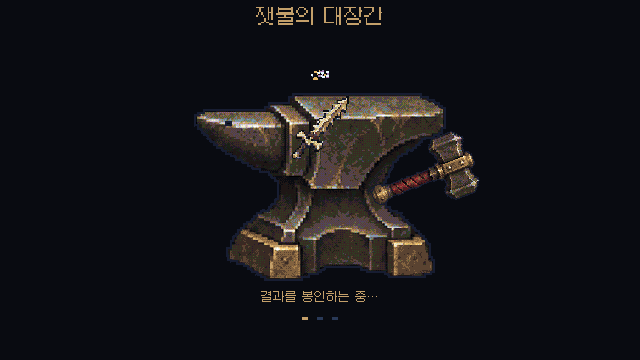

## 작업 결과

당시 세션의 결과 보고를 복원했습니다. 아래 기록은 해당 작업 시점의 결과이며 최신 버전 재검증을 뜻하지 않습니다.

## 변경 내용

### 적용 내용

**제가 흰색에 가까운 픽셀만 검사해서 누런 테두리·대각선 경계·열린 상자의 절단면을 놓쳤습니다. 완료 판단이 잘못됐습니다.**

이번에는 색과 관계없이 **전체 실루엣에 1~2px 어두운 외곽선**을 적용하고, 상자 덮개와 본체도 각각 처리했습니다. 실제 Godot에서 세 화면을 다시 확인했습니다.

제안: 5~8분 · 실제 **3분 12초**, **14:29:25 KST 완료**. 구현·실행 확인 완료, 빌드·배포 없음.

## 검증

당시 세션 최종 보고에 명시된 검증 범위만 기록했습니다. 이번 등록에서는 게임 실행·청감·밸런스를 재검증하지 않았습니다.

## 남은 사항

현재 버전 동작은 미확인입니다. 기존 기록의 미확인·경고·후속 수정은 적용 내용에 보존했습니다. 원본 세션 전체 로그는 공개하지 않았습니다.

## 작업 시간

- 제안 시간: 당시 보고의 제안 시간 참조. 없으면 미기록.
- 실제로 완료된 시간: 당시 세션 종료: 2026-11-17T05:29:32.000Z / 세션 턴 실측 209초. 보고서 복원: 2026-11-17T07:40:29.768Z
- XERJ: 미사용 — 코드 검색 근거가 제공되지 않았습니다.
