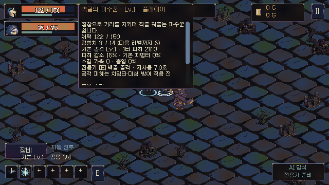
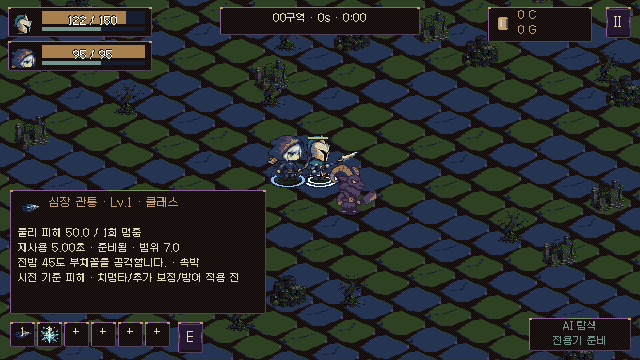

## 작업 결과

당시 세션의 결과 보고를 복원했습니다. 아래 기록은 해당 작업 시점의 결과이며 최신 버전 재검증을 뜻하지 않습니다.

## 변경 내용

### 적용 내용

실제 Godot 렌더링으로 확인했습니다. 체력 바 숫자와 스킬 아이콘이 표시되며, 캐릭터 툴팁의 긴 내용은 스크롤됩니다.

캐릭터 툴팁·체력 바:

스킬 아이콘·설명:

캡처는 툴팁을 직접 표시해 촬영했으며, 실제 마우스 호버 입력은 **미확인**입니다. 저장 경로·종료 시 리소스 경고가 남았습니다.

제안 시간: 3~5분 / 실제 소요: 약 1분 32초  
완료: 14:27:56 KST

## 검증

당시 세션 최종 보고에 명시된 검증 범위만 기록했습니다. 이번 등록에서는 게임 실행·청감·밸런스를 재검증하지 않았습니다.

## 남은 사항

현재 버전 동작은 미확인입니다. 기존 기록의 미확인·경고·후속 수정은 적용 내용에 보존했습니다. 원본 세션 전체 로그는 공개하지 않았습니다.

## 작업 시간

- 제안 시간: 당시 보고의 제안 시간 참조. 없으면 미기록.
- 실제로 완료된 시간: 당시 세션 종료: 2026-11-17T05:28:07.000Z / 세션 턴 실측 110초. 보고서 복원: 2026-11-17T07:40:29.791Z
- XERJ: 미사용 — 코드 검색 근거가 제공되지 않았습니다.
