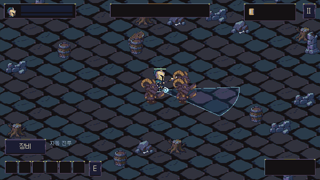

## 작업 결과

당시 세션의 결과 보고를 복원했습니다. 아래 기록은 해당 작업 시점의 결과이며 최신 버전 재검증을 뜻하지 않습니다.

## 변경 내용

### 적용 내용

스킬 발동 전에 **위치·방향·범위와 충전 진행도**가 표시되도록 확장했습니다.

- 원형·부채꼴·발사선·연쇄 대상·궤도 범위를 구분
- 맵의 눕혀진 바닥 각도에 맞춰 표시
- 이동형은 캐릭터를 따라가고, 지점형은 위치 고정
- 취소·사망 시 표시 제거

저장·문법 확인과 대표 6종의 실제 Godot 렌더링을 완료했습니다. 전체 스킬의 체감 밸런스는 미확인입니다.

제안 7분 / 실제 **3분 44초**, **14:44:33 KST 완료**.

## 검증

당시 세션 최종 보고에 명시된 검증 범위만 기록했습니다. 이번 등록에서는 게임 실행·청감·밸런스를 재검증하지 않았습니다.

## 남은 사항

현재 버전 동작은 미확인입니다. 기존 기록의 미확인·경고·후속 수정은 적용 내용에 보존했습니다. 원본 세션 전체 로그는 공개하지 않았습니다.

## 작업 시간

- 제안 시간: 당시 보고의 제안 시간 참조. 없으면 미기록.
- 실제로 완료된 시간: 당시 세션 종료: 2026-11-17T05:44:40.000Z / 세션 턴 실측 239초. 보고서 복원: 2026-11-17T07:40:29.752Z
- XERJ: 미사용 — 코드 검색 근거가 제공되지 않았습니다.
