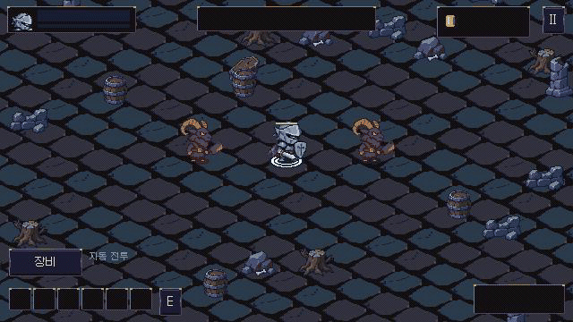

## 작업 결과

당시 세션의 결과 보고를 복원했습니다. 아래 기록은 해당 작업 시점의 결과이며 최신 버전 재검증을 뜻하지 않습니다.

## 변경 내용

### 적용 내용

**퍼지는 음파를 더 화려하게 보강했습니다.**

굵은 4겹 파동에 금빛 잔광·청백색 파편·별빛을 추가했습니다. 정규화와 Godot 좌우 발사 확인을 완료했습니다. 기존 종료 시 그래픽 정리 경고는 남아 있습니다.

[소리 포함 영상](../assets/history/01a1e806-7593-7d20-ac9f-44dbd37e8ce7-trumpet-fancy.mp4)

제안 5~8분 / 실제 **1분 37초**, 완료 **14:43:25 KST**.

## 검증

당시 세션 최종 보고에 명시된 검증 범위만 기록했습니다. 이번 등록에서는 게임 실행·청감·밸런스를 재검증하지 않았습니다.

## 남은 사항

현재 버전 동작은 미확인입니다. 기존 기록의 미확인·경고·후속 수정은 적용 내용에 보존했습니다. 원본 세션 전체 로그는 공개하지 않았습니다.

## 작업 시간

- 제안 시간: 당시 보고의 제안 시간 참조. 없으면 미기록.
- 실제로 완료된 시간: 당시 세션 종료: 2026-11-17T05:43:32.000Z / 세션 턴 실측 113초. 보고서 복원: 2026-11-17T07:40:29.550Z
- XERJ: 미사용 — 코드 검색 근거가 제공되지 않았습니다.
