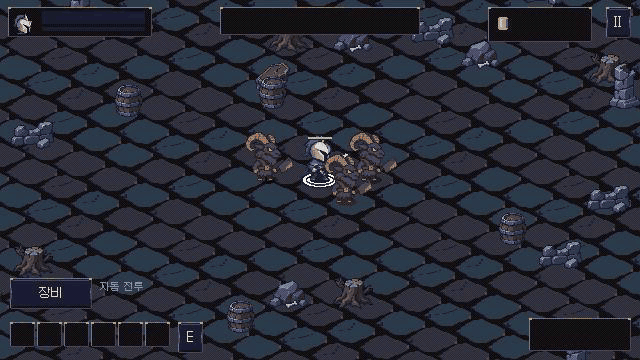

## 작업 결과

당시 세션의 결과 보고를 복원했습니다. 아래 기록은 해당 작업 시점의 결과이며 최신 버전 재검증을 뜻하지 않습니다.

## 변경 내용

### 적용 내용

**기존 모션 반복을 걷어내고, 8클래스 공격을 새로 그려 연결했습니다.** 클래스당 24자세, 총 192자세입니다.

| 클래스 | 구현한 공격 |
|---|---|
| 창기사 | **상단→중단→하단**, 성장에 따라 3~6연타 |
| 특대검 | 이동하며 몸 전체가 회전하는 훨윈드 |
| 검·방패 | 내려베기→올려베기 브랜디쉬형 2연격 |
| 궁수 | 표적을 분산하는 속사 |
| 쌍검 | 양손 교대 베기→교차 마무리·출혈 |
| 흑마도사 | 일직선 관통 마력창 |
| 도끼 | 내려찍기→낮은 횡베기·넉백 |
| 총 | 반동을 동반한 집중 점사 |

[훨윈드 공식 자료](https://classic.battle.net/diablo2exp/skills/barbarian-combatskills.shtml), [브랜디쉬 자료](https://global.hidden-street.net/character/skill/brandish), [스트레이프 공식 자료](https://classic.battle.net/diablo2exp/skills/amazon-bow.shtml)를 참고했습니다. 내장 imagegen으로 제작한 원본 경로·전체 프롬프트 (당시 로컬 자료; 공개 첨부 미확인)를 보존했습니다.

실제 Godot 렌더입니다. 순서는 창기사→특대검→검방패입니다.

[8클래스 전체 전투 영상 24초](../assets/history/01a1e80a-220d-7372-b881-8287f62a185d-class-attacks-v5.mp4)

구현·저장·Godot 임포트·컴파일 완료, 실제 실행에서 8클래스 피해 발생과 데이터 참조 오류 없음을 확인했습니다. 종료 시 텍스처 해제 경고는 남았으며, 청감·장기 밸런스는 **미확인**입니다. 관련 프로젝트 지침도 갱신했습니다. 푸시·배포는 수행하지 않았습니다.

**제안 시간:** 추가 범위 20~30분  
**실제:** 최초 착수부터 16분 1초, 2026-11-17 15:01:48 KST 완료

## 검증

당시 세션 최종 보고에 명시된 검증 범위만 기록했습니다. 이번 등록에서는 게임 실행·청감·밸런스를 재검증하지 않았습니다.

## 남은 사항

현재 버전 동작은 미확인입니다. 기존 기록의 미확인·경고·후속 수정은 적용 내용에 보존했습니다. 원본 세션 전체 로그는 공개하지 않았습니다.

## 작업 시간

- 제안 시간: 당시 보고의 제안 시간 참조. 없으면 미기록.
- 실제로 완료된 시간: 당시 세션 종료: 2026-11-17T06:02:06.281Z / 세션 턴 실측 986초. 보고서 복원: 2026-11-17T07:40:29.494Z
- XERJ: 미사용 — 코드 검색 근거가 제공되지 않았습니다.
