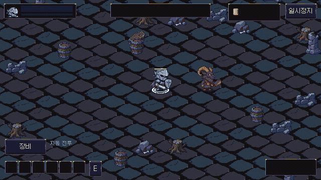

## 작업 결과

당시 세션의 결과 보고를 복원했습니다. 아래 기록은 해당 작업 시점의 결과이며 최신 버전 재검증을 뜻하지 않습니다.

## 변경 내용

### 적용 내용

**트럼펫을 ‘봉인의 파열’이라는 철제 유물로 교체하고, 독안개도 수정했습니다.**

- 사슬·뼈 보강대·청록 균열의 봉인함과 금속 파열음으로 변경
- 둥근 독연기가 몬스터를 따라 움직이고 이동 경로에 잔류
- 겹친 독안개의 중복 피해 방지

Godot에서 외형·연기 추적·피해를 확인했습니다. 청감은 미확인이며 기존 종료 시 그래픽 정리 경고는 남아 있습니다.

[소리 포함 영상](../assets/history/01a1e823-0321-7470-9704-312876607ebb-seal-poison.mp4)

제안 5~10분 / 실제 **6분 20초**, 완료 **15:19:22 KST**. 푸시·배포는 하지 않았습니다.

## 검증

당시 세션 최종 보고에 명시된 검증 범위만 기록했습니다. 이번 등록에서는 게임 실행·청감·밸런스를 재검증하지 않았습니다.

## 남은 사항

현재 버전 동작은 미확인입니다. 기존 기록의 미확인·경고·후속 수정은 적용 내용에 보존했습니다. 원본 세션 전체 로그는 공개하지 않았습니다.

## 작업 시간

- 제안 시간: 당시 보고의 제안 시간 참조. 없으면 미기록.
- 실제로 완료된 시간: 당시 세션 종료: 2026-11-17T06:19:35.000Z / 세션 턴 실측 404초. 보고서 복원: 2026-11-17T07:40:29.545Z
- XERJ: 미사용 — 코드 검색 근거가 제공되지 않았습니다.
