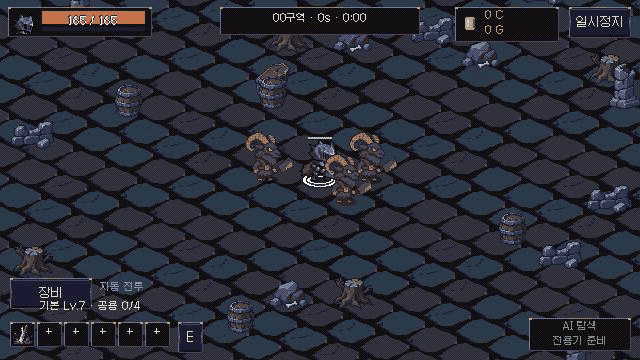

## 작업 결과

당시 세션의 결과 보고를 복원했습니다. 아래 기록은 해당 작업 시점의 결과이며 최신 버전 재검증을 뜻하지 않습니다.

## 변경 내용

### 적용 내용

**8클래스 모두 기존 일반 평타를 복원하고, 새 기술을 별도 자동 스킬로 분리했습니다.**

- 평소에는 기존 평타, 새 기술은 **5~7초 재사용**으로 발동합니다.
- 특대검은 보정한 등각 시점 회전과 앞·뒤 타원 궤적을 유지했습니다.
- 전 클래스에 궤적·발사·비행·명중 FX를 연결했습니다.
- 동료도 평타와 기존 역할 능력을 유지합니다.

[8클래스 전체 실행 영상](../assets/history/01a1e824-4dbf-7750-9360-a9da01394cf8-class-skills-separated-v6.mp4)

Godot 컴파일·실제 실행에서 8클래스 모두 평타와 스킬 발동을 확인했습니다. 종료 시 기존 텍스처 해제 경고는 남았습니다. 관련 지침도 갱신했으며 푸시·배포는 하지 않았습니다.

제안 15~25분 → 실제 **20분 20초**, 15:34:44 KST 완료.

## 검증

당시 세션 최종 보고에 명시된 검증 범위만 기록했습니다. 이번 등록에서는 게임 실행·청감·밸런스를 재검증하지 않았습니다.

## 남은 사항

현재 버전 동작은 미확인입니다. 기존 기록의 미확인·경고·후속 수정은 적용 내용에 보존했습니다. 원본 세션 전체 로그는 공개하지 않았습니다.

## 작업 시간

- 제안 시간: 당시 보고의 제안 시간 참조. 없으면 미기록.
- 실제로 완료된 시간: 당시 세션 종료: 2026-11-17T06:35:08.000Z / 세션 턴 실측 1253초. 보고서 복원: 2026-11-17T07:40:29.482Z
- XERJ: 미사용 — 코드 검색 근거가 제공되지 않았습니다.
