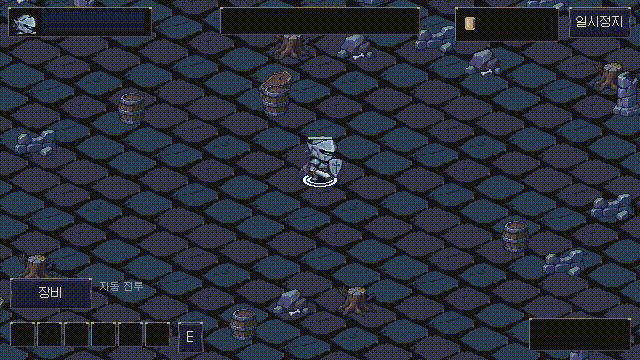

## 작업 결과

당시 세션의 결과 보고를 복원했습니다. 아래 기록은 해당 작업 시점의 결과이며 최신 버전 재검증을 뜻하지 않습니다.

## 변경 내용

### 적용 내용

웨이브 편성을 **8종**으로 늘렸습니다.

- 일반: 밀집 진입·양익 협공·시간차 진입·탈출구가 있는 포위
- 특수: **24마리 대열·25마리 쐐기·32마리 교차 대열·30마리 양방향 종대**

같은 종류끼리 편성하고 종족을 교대합니다. 특수 대열은 기본 12초 간격으로 등장하며 접촉 피해를 유지합니다.

실제 Godot에서 8종 스폰·렌더를 확인했습니다. 전체 플레이 난이도는 미확인입니다.

[전체 8종 영상](../assets/history/01a1e828-affb-73d2-86bf-7edf829bd523-wave-patterns.mp4)

제안 5~10분 / 실제 **4분 6초**, **15:23:17 KST 완료**. 저장·실행 확인 완료, 푸시·배포 없음.

## 검증

당시 세션 최종 보고에 명시된 검증 범위만 기록했습니다. 이번 등록에서는 게임 실행·청감·밸런스를 재검증하지 않았습니다.

## 남은 사항

현재 버전 동작은 미확인입니다. 기존 기록의 미확인·경고·후속 수정은 적용 내용에 보존했습니다. 원본 세션 전체 로그는 공개하지 않았습니다.

## 작업 시간

- 제안 시간: 당시 보고의 제안 시간 참조. 없으면 미기록.
- 실제로 완료된 시간: 당시 세션 종료: 2026-11-17T06:23:26.000Z / 세션 턴 실측 264초. 보고서 복원: 2026-11-17T07:40:29.575Z
- XERJ: 미사용 — 코드 검색 근거가 제공되지 않았습니다.
