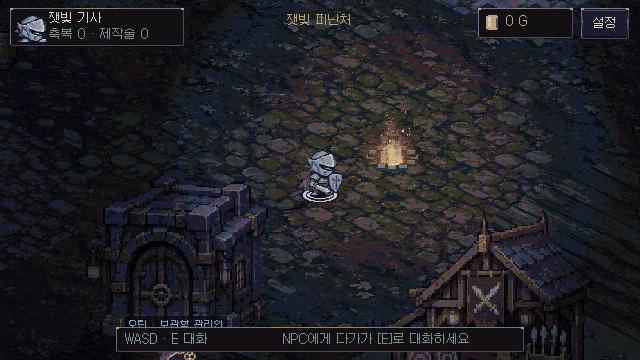

## 작업 결과

당시 세션의 결과 보고를 복원했습니다. 아래 기록은 해당 작업 시점의 결과이며 최신 버전 재검증을 뜻하지 않습니다.

## 변경 내용

### 적용 내용

마을의 노란색 편중을 줄이고 청회색 야경으로 수정했습니다.

- 중앙 불: 움직이는 불꽃·연기·불티와 국소 조명 적용.
- 건물: 기존 외형을 살리면서 시설별 크기·색조·그림자 차별화.
- 가시성: 어두운 곳에서도 지붕과 건물 윤곽이 보이도록 보정.

실제 Godot 렌더와 데이터 오류 없음 확인했습니다. 기존 종료 시 텍스처 해제 경고는 남아 있습니다. 별도 빌드·배포는 하지 않았습니다.

제안 시간: 8~10분 / 실제 소요: **4분 22초**
완료: **2026-11-17 15:35 KST**

## 검증

당시 세션 최종 보고에 명시된 검증 범위만 기록했습니다. 이번 등록에서는 게임 실행·청감·밸런스를 재검증하지 않았습니다.

## 남은 사항

현재 버전 동작은 미확인입니다. 기존 기록의 미확인·경고·후속 수정은 적용 내용에 보존했습니다. 원본 세션 전체 로그는 공개하지 않았습니다.

## 작업 시간

- 제안 시간: 당시 보고의 제안 시간 참조. 없으면 미기록.
- 실제로 완료된 시간: 당시 세션 종료: 2026-11-17T06:35:21.501Z / 세션 턴 실측 280초. 보고서 복원: 2026-11-17T07:40:29.518Z
- XERJ: 미사용 — 코드 검색 근거가 제공되지 않았습니다.
