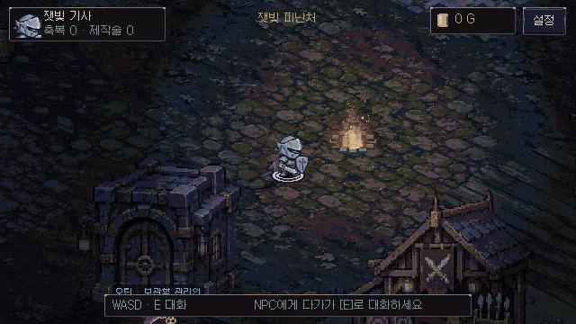

## 작업 결과

당시 세션의 결과 보고를 복원했습니다. 아래 기록은 해당 작업 시점의 결과이며 최신 버전 재검증을 뜻하지 않습니다.

## 변경 내용

### 적용 내용

건물 14개를 이전보다 **약 1.5~1.8배 확대**하고, 크기 차이도 더 크게 줬습니다.

- 성문·여관·성소는 크게
- 대장간·훈련소는 중간 크기
- 천막·마차·게시판은 서로 다른 작은 크기

그림자·충돌·NPC 접근 위치도 맞췄으며, 실제 Godot 렌더를 확인했습니다.

제안: 3~5분 / 실제: **52초**, 완료 **16:10 KST**.
빌드·배포는 하지 않았습니다.

## 검증

당시 세션 최종 보고에 명시된 검증 범위만 기록했습니다. 이번 등록에서는 게임 실행·청감·밸런스를 재검증하지 않았습니다.

## 남은 사항

현재 버전 동작은 미확인입니다. 기존 기록의 미확인·경고·후속 수정은 적용 내용에 보존했습니다. 원본 세션 전체 로그는 공개하지 않았습니다.

## 작업 시간

- 제안 시간: 당시 보고의 제안 시간 참조. 없으면 미기록.
- 실제로 완료된 시간: 당시 세션 종료: 2026-11-17T07:10:47.590Z / 세션 턴 실측 71초. 보고서 복원: 2026-11-17T07:40:29.522Z
- XERJ: 미사용 — 코드 검색 근거가 제공되지 않았습니다.
