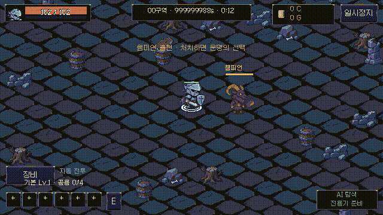

## 작업 결과

당시 세션의 결과 보고를 복원했습니다. 아래 기록은 해당 작업 시점의 결과이며 최신 버전 재검증을 뜻하지 않습니다.

## 변경 내용

### 적용 내용

**챔피언을 처치하면 ‘운명의 선택’ 증강을 얻도록 변경했습니다.**

- 챔피언: 첫 12초 후 등장, 이후 26초 간격·동시 1마리
- 체력 5배, 금색 이름표·전용 체력바로 구분
- 처치당 선택권 1개, 중복 지급 방지
- 시간 경과·레벨업에 따른 자동 선택은 제거

실제 실행에서 **레벨업 보상 0개 → 챔피언 처치 보상 1개 → 선택 카드 3장 표시**를 확인했습니다. 체감 밸런스는 미확인입니다.

제안 5~10분 / 실제 **2분 7초**, **16:12:36 KST 완료**. 저장·실행 확인 완료, 지침 갱신. 푸시·배포 없음.

## 검증

당시 세션 최종 보고에 명시된 검증 범위만 기록했습니다. 이번 등록에서는 게임 실행·청감·밸런스를 재검증하지 않았습니다.

## 남은 사항

현재 버전 동작은 미확인입니다. 기존 기록의 미확인·경고·후속 수정은 적용 내용에 보존했습니다. 원본 세션 전체 로그는 공개하지 않았습니다.

## 작업 시간

- 제안 시간: 당시 보고의 제안 시간 참조. 없으면 미기록.
- 실제로 완료된 시간: 당시 세션 종료: 2026-11-17T07:12:46.000Z / 세션 턴 실측 149초. 보고서 복원: 2026-11-17T07:40:29.565Z
- XERJ: 미사용 — 코드 검색 근거가 제공되지 않았습니다.
