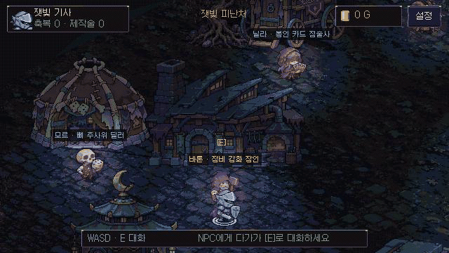

## 작업 결과

당시 세션의 결과 보고를 복원했습니다. 아래 기록은 해당 작업 시점의 결과이며 최신 버전 재검증을 뜻하지 않습니다.

## 변경 내용

### 적용 내용

**14개 시설을 각각 새 원본으로 다시 제작했습니다.** 기존 이미지를 늘리는 코드는 제거하고, 최종 크기 그대로 1:1로 표시합니다.

대장간은 톱니 슬레이트 지붕, 시장은 청록 천막, 금고는 석재 벙커, 점술소는 둥근 지붕 마차, 여관은 2층 목조 건물로 구조·재질을 구분했습니다. 건물 간격·충돌·NPC 접근 위치도 조정했습니다.

원본과 제작 프롬프트·규격 (당시 로컬 자료; 공개 첨부 미확인)을 저장했습니다. 실제 렌더에서 14시설 연결과 데이터 오류 없음을 확인했습니다. 전체 NPC 경로 실플레이는 미확인이며, 기존 종료 시 텍스처 해제 경고는 남았습니다. 빌드·배포는 하지 않았습니다.

제안 **15~20분** / 실제 **8분 48초**, 완료 **2026-11-17 16:20 KST**.

## 검증

당시 세션 최종 보고에 명시된 검증 범위만 기록했습니다. 이번 등록에서는 게임 실행·청감·밸런스를 재검증하지 않았습니다.

## 남은 사항

현재 버전 동작은 미확인입니다. 기존 기록의 미확인·경고·후속 수정은 적용 내용에 보존했습니다. 원본 세션 전체 로그는 공개하지 않았습니다.

## 작업 시간

- 제안 시간: 당시 보고의 제안 시간 참조. 없으면 미기록.
- 실제로 완료된 시간: 당시 세션 종료: 2026-11-17T07:20:41.878Z / 세션 턴 실측 549초. 보고서 복원: 2026-11-17T07:40:29.528Z
- XERJ: 미사용 — 코드 검색 근거가 제공되지 않았습니다.
