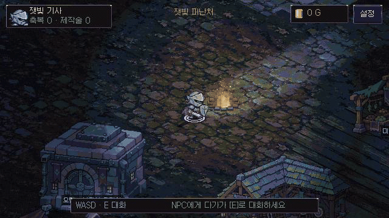

## 작업 결과

당시 세션의 결과 보고를 복원했습니다. 아래 기록은 해당 작업 시점의 결과이며 최신 버전 재검증을 뜻하지 않습니다.

## 변경 내용

### 적용 내용

제가 재질과 도트 밀도를 맞추지 못했습니다. **튀던 파란 대형 석판을 제거하고, 기존 마을의 낡은 돌 포장으로 교체했습니다.** 가장자리는 흙에 자연스럽게 섞고, 길 중심만 조금 밝게 했습니다.

구현·저장·Godot 렌더 확인 완료했습니다. 기존 종료 경고는 남아 있으며 별도 빌드·배포는 하지 않았습니다.

제안 **3~5분** / 실제 **2분 18초**, 완료 **16:31 KST**.

## 검증

당시 세션 최종 보고에 명시된 검증 범위만 기록했습니다. 이번 등록에서는 게임 실행·청감·밸런스를 재검증하지 않았습니다.

## 남은 사항

현재 버전 동작은 미확인입니다. 기존 기록의 미확인·경고·후속 수정은 적용 내용에 보존했습니다. 원본 세션 전체 로그는 공개하지 않았습니다.

## 작업 시간

- 제안 시간: 당시 보고의 제안 시간 참조. 없으면 미기록.
- 실제로 완료된 시간: 당시 세션 종료: 2026-11-17T07:31:49.000Z / 세션 턴 실측 159초. 보고서 복원: 2026-11-17T07:40:29.507Z
- XERJ: 미사용 — 코드 검색 근거가 제공되지 않았습니다.
