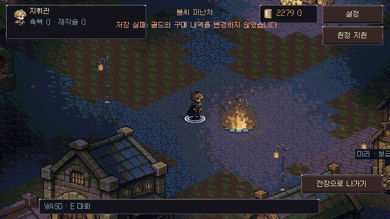

## 작업 결과

셰이더 수정·저장·실제 Godot 좌우 렌더 확인 완료. 게임 빌드·배포 미실행.

## 변경 내용

### 적용 내용

town_commander.gd의 음수 X 배율로 그림은 반전하지만 노멀 X는 그대로였습니다. actor_relief.gdshader에서 UV 수평 미분 부호로 반전을 판별해 노멀 X를 캔버스 방향에 맞췄습니다. 이미 반전된 이미지로 베이크한 노멀은 중복 반전하지 않습니다. 기존 광원·원본은 보존했습니다. 기존 조명 좌표 규칙 내의 오류 수정으로 지침 변경 없음.

## 검증

Godot4.7.2/OpenGL Compatibility/GTX970의 현재 boot.tscn에서 동일 위치·대기 자세·조명으로 좌우를 실제 렌더해 직접 확인했습니다. LIGHT_FACING_CAPTURE_COMPLETE errors=[]. 셰이더 오류 없음. 자동 테스트·회귀 미실행.

## 남은 사항

사용자 저장 경로 권한 오류 및 기존 종료 시 GL 텍스처 3개 해제 경고가 남습니다. 전체 배우 조합·플레이 체감 미확인. EXE 빌드·게임 배포 미실행. 중앙 푸시·배포·접근 확인은 별도입니다.

## 작업 시간

- 제안 시간: 2026-11-18 13:17:46 KST 시작, 5~10분.
- 실제로 완료된 시간: 구현·렌더 확인 완료 2026-11-18 13:20:26 KST. 중앙 등록 별도.
- XERJ: 미사용 — rg·소스·Godot 실행 로그·실제 렌더를 확인했습니다.
