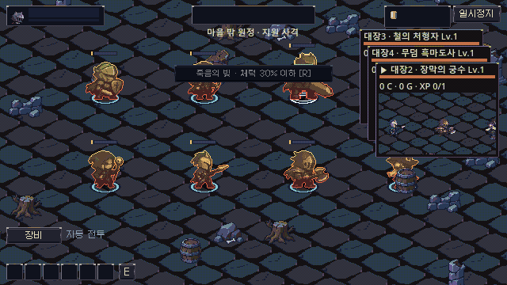

## 작업 결과

구현·원본/출력 저장·Godot 실제 렌더 확인 완료. 고용 부하 시전은 기존 자세를 재사용합니다.

## 변경 내용

### 적용 내용

8클래스별 새 시전8자세, 특대검16자세 이동 원본을 보존하고 정규화했습니다. cast_started/cast_until로 자세·게이지·슈퍼아머를 통일했습니다. 고용 부하는0.35초 시전 후 능력을 발동합니다. 특대검 전투 표시1.15배와 공격 부착점 배율을 연결했습니다. 아트 지침/제작기/스타일 메타데이터를 갱신했습니다.

## 검증

Godot4.7.2/OpenGL 실제 렌더96프레임.8클래스pose203/armor=true/진행0.3958 로그와 시전/걷기 화면 확인.8클래스 출력 프레임 전부 고유해시 확인. 자동 테스트 미실행. 종료 시 기존GL 텍스처 해제 경고가 남습니다.

## 남은 사항

고용 부하12종 실제 시전·피격 상황 및 전체 스킬별 발동 타이밍 미확인. 배포 빌드 미실행. 최종 사용자 시각 승인 미확인. 조명 베이크 일부 NPC 경로 경고는 별도입니다.

## 작업 시간

- 제안 시간: 2026-11-18 13:15:44 KST 시작, 예상10분.
- 실제로 완료된 시간: 2026-11-18 13:24 KST 구현·실제 렌더 완료, 약8분20초. 중앙 등록은 별도 진행.
- XERJ: 미사용 — rg,소스,정규화 출력,실제 Godot 렌더와 로그.
