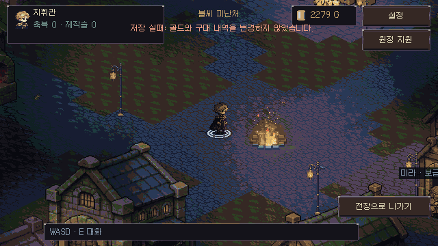

## 작업 결과

지휘관 기존 명암 복구·저장·실제 렌더 확인 완료. 전체 베이크 누락 경로 수정 완료.

## 변경 내용

### 적용 내용

실제 실행에서 Missing baked actor relief: res://art/environments/town/commander.png 경고를 확인했습니다. manifest 수정 시각은 13:24:08 KST로 이전 실제 렌더 이후입니다. 지휘관 베이크와 manifest 연결을 복구하고 normalize-art.mjs를 거쳤습니다. 전체 베이크는 기존 항목을 보존하고 지휘관을 명시적으로 포함하도록 수정했습니다. 밝기 조정 시도는 원인을 확인한 뒤 철회했으며 최종 셰이더의 주변광·직접광·명암 단계·상한은 이전 값 그대로입니다. 좌우 노멀 반전 수정 유지. AGENTS.md에 누락 확인 교훈을 통합했습니다.

## 검증

Godot4.7.2/OpenGL/GTX970 실제 실행에서 복구 전 누락 경고 확인, 복구 후 같은 위치 좌우 렌더와 경고 소멸 확인. LIGHT_FACING_CAPTURE_COMPLETE errors=[]. 어두운 몸통과 불 쪽 밝은 면을 직접 확인했습니다. 전체 베이크는 소스 수정 확인이며 전체 재생성은 미실행. 테스트·회귀 미실행.

## 남은 사항

전체 베이크 재실행·전체 배우·사용자 체감 승인 미확인. 게임 빌드·배포 미실행. 기존 저장 경로·종료 텍스처 경고 잔존. 중앙 보고 배포는 별도 확인.

## 작업 시간

- 제안 시간: 2026-11-18 13:37:40 KST 시작, 5~10분.
- 실제로 완료된 시간: 구현·실제 렌더 확인 2026-11-18 13:39:09 KST, 1분29초. 중앙 등록 시간 별도.
- XERJ: 미사용 — rg·소스·Godot 실행 로그·실제 렌더를 확인했습니다.
