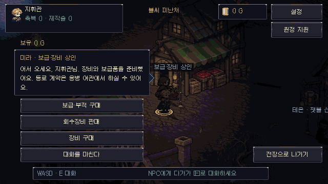

## 작업 결과

구현·저장·정규화·Godot 임포트 및 실제 OpenGL 렌더 확인 완료. 상점 서비스 전환 확인 완료.

## 변경 내용

### 적용 내용

npc_dialogue.gd의 첫 대화에 월드 말풍선 모드를 추가했습니다. 기존 전체 일러스트 대신 마을과 NPC를 보여 주고 이름·대사를 말풍선에 표시하며 서비스와 종료 버튼은 별도 세로 버블로 배치합니다. town.screen 투영을 사용해 NPC 옆에 배치하고 화면 경계를 보정합니다. 버튼은 번들 픽셀 글꼴·기존 도트 프레임을 유지하고 문장 높이에 맞춰 줄바꿈합니다. 바깥 클릭과 기존 Esc 닫기를 지원하며 닫기 클릭은 마을에 전달하지 않습니다. 서비스 선택 뒤 전용 강화·상점·고용 화면과 기존 결제 로직을 유지합니다. tools/export-dialogue-tail.py 원본에서 말풍선 꼬리를 생성하고 해당 PNG만 정규화했습니다. 기존 디자인 기준을 재사용했으며 공통 지침 변경 없음.

## 검증

Godot 4.7.2 임포트 완료. 실제 OpenGL Compatibility/GTX 970 렌더에서 미라 대화 표시: modal=shop, page_visible=true, choices=4, position=(28,97), data.errors=[]. 640×360 실제 렌더 PNG 확인: 대사와 버튼 분리·프레임·한국어 줄바꿈 확인. 첫 서비스 버튼 pressed 신호로 상점 진입 확인: modal=shop, bubble_removed=true. 종료코드 0. 별도 테스트·회귀 테스트 미실행.

## 남은 사항

한국어 미라 화면을 확인했으며 다른 NPC·11개 언어 전체 및 마우스/키보드 실제 입력은 미확인. 캐시 폴더 쓰기 권한 경고와 종료 시 GL 텍스처 3개 정리 경고 발생. 프로젝트 빌드·커밋·푸시·배포 미실행. 중앙 결과 보고 게시 상태는 별도 확인.

## 작업 시간

- 제안 시간: 5~10분. 시작 2026-11-18 13:39:37 KST.
- 실제로 완료된 시간: 구현·렌더 확인 완료 2026-11-18 13:43:05 KST, 실측 209초. 중앙 등록 시간 별도.
- XERJ: 미사용 — 로컬 코드와 실제 Godot 렌더·서비스 전환 로그를 확인했습니다.
