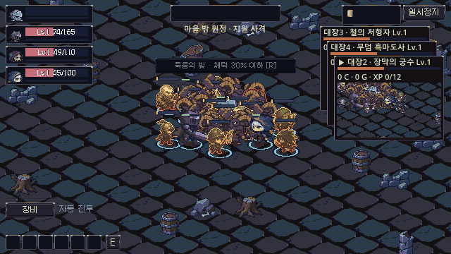

## 작업 결과

구현·저장·Godot 실제 전투 실행 검증 완료.12병과20초 자동 교전과E8종 실제 이동,일시정지 확인 완료.

## 변경 내용

### 적용 내용

7클래스 E 전용기에0.18초 준비 시간을 추가해 캐스팅 자세·청색 게이지·슈퍼아머를 연결했습니다. 기존 장창 준비 시간은 유지하고 장창 전용 직선 가이드는 다른 E에 표시하지 않습니다. 연속 베기의 게이지 종료를 첫 타격0.25초에 맞췄습니다. casting.cancel로 취소/사망 시 게이지·예약 부하 능력·캐스팅 애니메이션을 함께 정리하고 오래된 anim 기반 슈퍼아머 폴백을 제거했습니다. 프로젝트 지침에 검증된 시전·취소 규칙을 통합했습니다.

## 검증

Godot4.7.2/OpenGL GTX970에서 실제 expedition._process와 use_skill/kit.activate/companion use_ability 경로를 실행했습니다.30개 스킬의 호환 클래스 전체86조합+E8종+부하12병과=106조합 통과. 각 시전 중 실제 damage/knockback/knockup 경로로 피해 수신·경직/이동/공중 제어 방어,시전 자세/게이지 진행/종료,발동 전 피해 방지를 확인했습니다. 고유 스킬30+E8+부하12에 침묵/빙결/공포를 적용한150취소 조합 통과. 일반 공격 재개는 취소 스킬 피해와 분리했습니다. E8종 실제 이동 통과. 추가20초 자율 교전에서12병과 전원 시전,시전608프레임 모션/슈퍼아머 누락0. 실제 엔진 일시정지 시 clock/게이지 정지 확인. 종료 시 기존GL 텍스처 해제 경고는 남습니다.

## 남은 사항

장기 난이도·최종 사용자 체감은 미확인. 내보내기 빌드/게임 배포는 미실행. 보고서 푸시·배포·HTTPS는 별도 확인합니다.

## 작업 시간

- 제안 시간: 2026-11-18 13:35:51 KST 시작, 예상10분.
- 실제로 완료된 시간: 2026-11-18 13:43 KST 구현·실제 전투 확인 완료, 약7분20초. 보고서 등록 시간은 별도입니다.
- XERJ: 미사용 — rg,스킬/클래스/부하 데이터,Godot 실제 전투 실행 로그,구조화 검증 결과와 실제 렌더 GIF.
