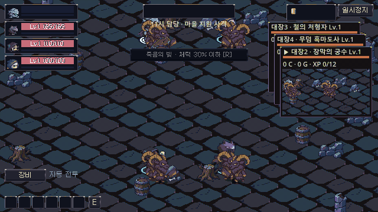

## 작업 결과

구현·저장·실제Godot15초 교전 및대장 전환 후 배치 확인 완료.

## 변경 내용

### 적용 내용

기존 captain_lanes 배정 순서를 유지하면서 원정 출발 중심의 화면 오프셋(-64,-111)/(64,-111)/(64,111)/(-64,111)에 대장4명을 분산했습니다. 매 프레임 다른 대장의 복귀점을 첫 대장 위치로 옮기던 코드를 제거했습니다. 자동 추적·공격 대상·재화 접근·순찰 복귀·회피 방향에 담당 구역과 대장 간격 비용을 적용했습니다. 부하는 자기 대장을 계속 호위하고 수동 이동은 유지합니다. 선택 대장의 방향과 팝업 툴팁에 담당 방향을 표시합니다. captain_sectors.json으로 배치/순찰/간격을 분리하고 프로젝트 지침에 통합했습니다.

## 검증

Godot4.7.2/OpenGL 실제15초 교전. 시작 화면 좌표11시(-64,-111),1시(64,-111),5시(64,111),7시(-64,111). 대장2회 전환 후4명 전원 home_stable=true/own_sector=true. 교전 중 대장 간 최소 거리3.6409월드 단위. 실제 렌더 확인. 요청 없는 자동 테스트 미실행. 기존 종료시GL 텍스처 해제 경고는 남습니다.

## 남은 사항

장기 교전·수동 이동 후 복귀 체감 미확인. 게임 내보내기/배포 미실행. 보고서 공개 배포 상태는 별도 확인합니다.

## 작업 시간

- 제안 시간: 2026-11-18 14:01:29 KST 시작, 예상5분.
- 실제로 완료된 시간: 2026-11-18 14:04:09 KST 구현·실제 실행 확인 완료, 실측2분40초. 중앙 등록은 별도.
- XERJ: 미사용 — rg,복귀점/AI 소스,실제Godot 교전 로그와 렌더GIF.
