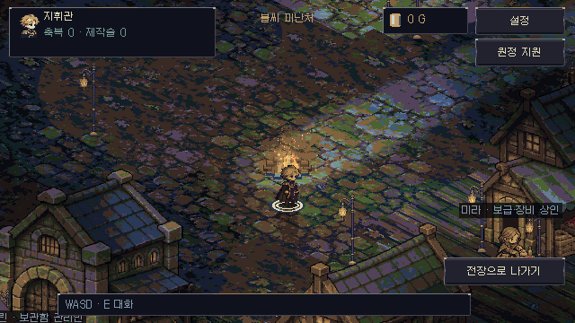

## 작업 결과

구현·저장·Godot 실제 렌더 확인 완료. 게임 EXE 빌드·배포 미실행.

## 변경 내용

### 적용 내용

town.gd는 배우 명암과 동일한 35개 모닥불·입구 등불·가로등·활성 성문 조명의 바닥 위치/높이/반경/에너지를 공유합니다. 물체별 영향이 큰 최대2광원을 선택하고 현재 자세/좌우 반전/발 피벗으로 실루엣을 투영합니다. 거리·높이에 따른 길이 상한과 끝부분 감쇠, 다른 광원에 의한 농도 완화를 적용했습니다. 사람의 사다리꼴과 모닥불 자체 투영을 제거했습니다. 설정의 그림자 끔/간단/광원 기반은 저장되며 기존 저장은 광원 기반으로 이전됩니다. 전투 접지 그림자도 끔 설정을 따릅니다. 원본 아트와 기존 다른 작업은 보존했습니다. 기존 좌표/아트 규칙 내 수정이므로 지침 추가 없음.

## 검증

Godot4.7.2 OpenGL Compatibility GTX970에서 boot.tscn 실제 실행·렌더. 모닥불 앞과 입구 등불 옆 및 설정 화면을 직접 확인했습니다. SHADOW_RENDER lights=35 mode=2 data_errors=[]. 수정 후 스크립트/셰이더 오류 없음. 자동 테스트/회귀 미실행.

## 남은 사항

그림자는 바닥 평면 투영이며 다른 물체와의 차폐 판정은 포함하지 않습니다. 모든 조명/배우 조합 및 옵션 재시작 실사용 미확인. 기존 user:// 로그/캐시 권한 및 종료 GL 자원 경고 잔존. EXE 빌드·게임 푸시·배포 미실행.

## 작업 시간

- 제안 시간: 2026-11-18 14:27:51 KST 시작, 7~10분.
- 실제로 완료된 시간: 구현·실제 렌더 확인 2026-11-18 14:32 KST, 약4분. 중앙 등록 시각은 게시 이력으로 구분합니다.
- XERJ: 미사용 — rg·소스·실제 Godot 실행 로그와 렌더 확인.
