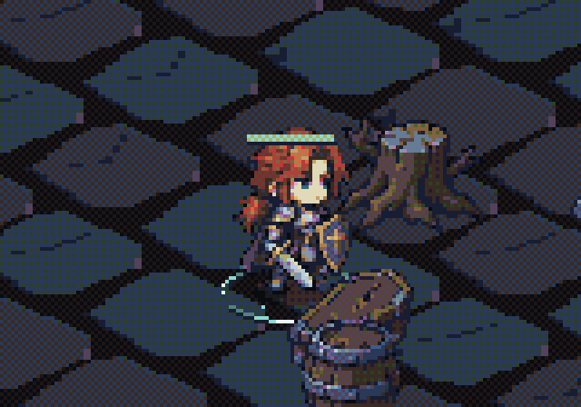

## 작업 결과

구현·저장·정규화·Godot 실제 48프레임 렌더 완료.

## 변경 내용

### 적용 내용

프로젝트 소유 PixelFX 생성기로 48×32/발(24,23)/48프레임을 제작했습니다. 기존 원본을 보존하고 선택 캐릭터와 동료 발밑에 적용했습니다. 동료는 낮은 밝기, 약한 연출은 정지 프레임을 사용합니다. 호버 때 기존 정적 타원이 중첩되는 출력을 제거하고 미니 화면에도 연결했습니다. 기존 PixelFX/정규화 규칙을 적용했으며 새 전역 교훈 추가는 없습니다.

## 검증

Godot 4.7.2/OpenGL에서 실제 전투 장면 2.4초 48프레임 렌더 및 발밑 위치 확인. 스크립트 오류 없음. 정규화/아틀라스 경계 확인. 테스트 미실행. 샌드박스 user 로그/캐시 권한 및 종료 시 기존 GL 리소스 해제 경고가 남았습니다.

## 남은 사항

실제 이동 중 장시간 시인성·약한 연출 설정의 실제 화면 미확인. 게임 빌드/내보내기/배포 미실행. 중앙 보고서 푸시·배포는 별도 확인.

## 작업 시간

- 제안 시간: 2026-11-18 15:26:06 KST 시작, 제안 5~8분.
- 실제로 완료된 시간: 2026-11-18 15:30:46 KST 구현·렌더 확인 완료, 실측 4분40초. 보고서 등록 별도.
- XERJ: 미사용 — 현재 마커 코드, PixelFX painter, 정규화 결과, 실제 Godot 렌더와 로그.
