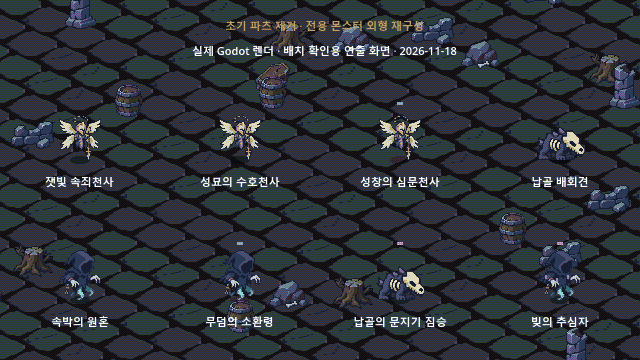
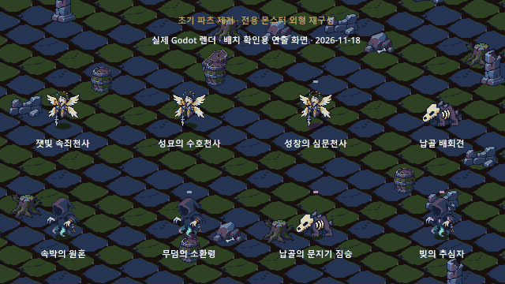

## 작업 결과

구현·문서 빌드와 실제 Godot 좌우 렌더 캡처를 완료했습니다. 신규 그림 제작이 아닌 기존 전용 몬스터 시트 재구성입니다.

## 변경 내용

### 적용 내용

초기 인간·엘프·해골 파츠 연결을 제거했습니다. 천사 3종은 seraph, 언데드 4종은 bone-hound/wraith로 교체하고 이름을 맞췄습니다. 염소 6종은 monster_goat를 데이터에 명시했습니다. 추심자는 revenant 외형을 사용합니다. ID·능력·수치·등장 조건과 초기 원본은 보존했습니다. 생성기 및 웹 문서와 자동 이미지도 동기화했습니다. 기존 지침에 따른 연결 정리로 별도 전역 규칙은 추가하지 않았습니다.

## 검증

데이터 33종 중 parts 외형 0개를 확인했습니다. node tools/build-design-catalog.mjs 및 node docs/build.mjs 성공(14페이지·이미지256개). Godot 4.7.2 headless 편집기 로딩 성공. 첫 시도 user:// 접근 오류는 프로젝트 내부 APPDATA로 해결했습니다. 테스트·회귀·GUI 실행은 하지 않았습니다.
후속 실제 Godot OpenGL 렌더에서 좌우 PNG 저장 성공(result=0), data_errors=[] 확인. 오른쪽 캡처를 직접 열어 천사·사냥개·망령 및 추심자 배치와 표시 이름을 확인했습니다. 촬영 스크립트 시작 조건 오류 수정 후 성공. 종료 시 기존 GL 텍스처3개 해제 경고가 남습니다.

## 남은 사항

실제 플레이 체감·청감·장기 밸런스는 미확인입니다. 캡처는 배치 확인용 연출 화면이며 플레이 진행 캡처와 구분합니다. 게임 저장소의 다른 작업 변경은 커밋·푸시하지 않았습니다. 중앙 보고 커밋·푸시·배포는 이 보고 생성 이후 확인합니다.

## 작업 시간

- 제안 시간: 구현 5~8분 / 후속 촬영·보고 공개 5~8분
- 실제로 완료된 시간: 구현·정리: 2026-11-18 15:48:38~15:52:20 KST(3분42초). 후속 촬영 시작 15:53:51 KST, 렌더 저장 완료 15:56:23 KST(약2분32초). 보고 게시 확인 이후 종료 시각 별도 안내.
- XERJ: 미사용 — 프로젝트 소스와 데이터 직접 확인
