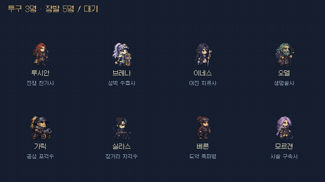

## 작업 결과

6개 편집 원본·프롬프트·정규화 출력·아이콘·미리보기 저장 및 실제 Godot64프레임 렌더 확인 완료. 게임 배포 빌드는 미실행입니다.

## 변경 내용

### 적용 내용

브레나(aegis)는 열린 면갑과 뒤쪽 흰색 포니테일,가릭(artillerist)은 포병 철모와 뒤로 묶은 금발,베른(saboteur)은 고글 달린 철제 투구와 뒤쪽 붉은 머리로 수정했습니다. 각 기본/시전48자세와 호흡8자세에 같은 투구를 반영했습니다. 새 원본은 art/source/roster-v14,정확한 내장 imagegen 편집 프롬프트는 tools/roster-v14-helmets.json,이전 원본/출력은 v13 및 v14/previous에 보존했습니다.3명 부분 출력과 아이콘을 연결하고 기준판/아트 가이드/스타일/프로젝트 지침을 갱신했습니다.

## 검증

Godot4.7.2/GTX970 OpenGL 실제64프레임,대기·걷기·공격·시전과좌우 출력 확인,종료0/실행 오류0.3명 모두46px 체형과80×80/발(40,64),48/48·대기8/8 고유 프레임 해시. 다른 클래스/부하 PNG96개 해시 동일,대장16/부하20 메타데이터 유지. 별도 테스트·전체 회귀는 요청하지 않아 작성/실행하지 않았습니다.

## 남은 사항

최종 사용자 디자인 평가는 미확인입니다. 게임 내보내기/배포와 전체 전투 재검사는 미실행입니다. 전체 용어 검사에서는 이번 변경 밖 monsters.json/build-monsters.mjs의 기존 금지어2건이 확인돼 이 작업에서 수정하지 않았습니다. 중앙 사이트는 앞선 작업에서 Cloudflare1042를 반환했으며 이번 결과 등록/푸시·배포·원본 HTTPS는 별도로 확인합니다.

## 작업 시간

- 제안 시간: 2026-11-18 15:49:51 KST 시작,10~15분 예상.
- 실제로 완료된 시간: 2026-11-18 16:00:37 KST 구현·저장·실제 렌더 완료,실측10분46초. 중앙 등록은 이후 별도 진행합니다.
- XERJ: 미사용 — rg·내장 imagegen 원본 편집·정규화·PNG 해시 대조·실제 Godot 렌더/로그.
