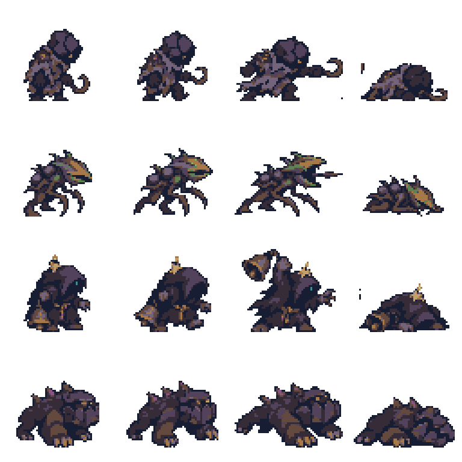
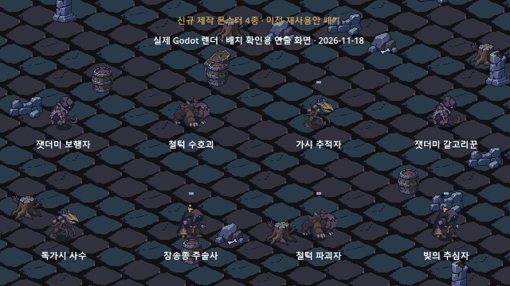

## 작업 결과

새 원본4장·64px 시트4종/16자세 제작, 정규화, 기존7종과 추심자 연결, 실제 Godot 좌우·걸음·공격 렌더 및 GIF 저장과 웹 문서 갱신 완료.

## 변경 내용

### 적용 내용

이전 보고의 seraph/wraith/bone-hound 재사용은 사용자가 요청한 신규 제작이 아니었습니다. 이 작업에서 대체했습니다. built-in image_gen으로 새 디자인4종을 각각 생성하고 원본·프롬프트·좌표·해시를 art/source/creatures/redesign-v2에 보존했습니다. export-monster-redesign-v2.mjs → normalize-art.mjs → Godot 임포트. 기존7종 호환 ID·수치는 유지하고 이름·계열·신규 시트를 연결했습니다. 추심자는 새 장송종 외형입니다. 제작기·스타일 설정·아트 가이드·웹 본문·미리보기를 동기화했습니다. 원본 보존 및 신규 제작 지시를 재사용으로 대체하지 않는 기존 원칙을 적용했으며 전역 규칙 추가 없음.

## 검증

Godot4.7.2 OpenGL 실제 렌더에서 right/left/step/attack PNG 저장 result=0 및 data_errors=[] 확인. 오른쪽 대기·공격 화면을 직접 열어 신규 실루엣과 자세를 확인했습니다. 원본4종도 직접 열어 대조했습니다. 문서 빌드 성공(14페이지·이미지260개). 일반 테스트·회귀는 수행하지 않았습니다. 종료 시 기존 GL 텍스처3개 해제 경고가 남습니다.

## 남은 사항

캡처는 배치 확인용 연출 화면입니다. 실제 처치 과정·장기 체감 밸런스·청감은 미확인입니다. 걷기는 대기+한 걸음2상태이며 상세 다프레임 모션은 미제작입니다. 능력·사운드·FX는 연결된 기존 리소스를 공유합니다. 게임 저장소의 다른 작업은 커밋·푸시하지 않았습니다. 중앙 게시 배포 확인은 보고 생성 이후 진행합니다.

## 작업 시간

- 제안 시간: 8~10분
- 실제로 완료된 시간: 2026-11-18 16:02:58 KST 시작, 신규 제작·연결·렌더·문서 갱신 16:09:20 KST 확인(6분22초). 보고 게시·배포 확인은 이후 진행.
- XERJ: 미사용 — 로컬 소스·자산·Godot 실행 직접 확인
