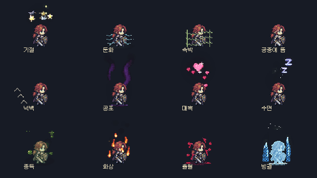

## 작업 결과

구현·저장·PixelFX 정규화·Godot12종 실제렌더·웹문서 갱신 완료. 사용자 최종 시각 승인과 난전 가독성은 미확인입니다.

## 변경 내용

### 적용 내용

삭제6종을 상태테이블/부여데이터/행동·시전·목표강제/로그·FX매핑에서 제거했습니다. 기존 공격의 안정ID·피해·범위·예고는 유지하며 해당상태를 부여하지 않습니다. 폐기저장상태는 has에서 무효화하고 tick에서 제거합니다. 둔화 시계를 제거하고 발목 냉기·서리흐름, 중독은 실제배우 병색·녹색독기·상승기포로 교체했습니다. PixelFX 프로젝트 소유 원본 tools/status-fx-v3.mjs와 poisoned_body.gd 캐시를 사용합니다. 둔화0.5배/중독피해/기존1.35배 FX확대는 유지합니다. 현행12종/앞뒤24시트이며 삭제출력은 원본영역에 보존했습니다. 관련데이터생성기와 웹/아트문서를 갱신했습니다.  참고: [LoL 애쉬](https://www.leagueoflegends.com/en-us/champions/ashe/), [신지드](https://www.leagueoflegends.com/en-us/champions/singed/). LoL 자산을 복사하지 않았습니다.

## 검증

Godot4.7.2/GTX970 OpenGL/48프레임 실제상태12종 갤러리 렌더,스크립트오류 없음. 폐기6종 부여참조/런타임체크 없음. 스킬·몬스터능력 상태참조 누락0. workbook 상태12행/FX12행. node tools/build-design-catalog.mjs 및 node docs/build.mjs 성공(12페이지/370이미지). 테스트·전체회귀는 요청하지 않아 실행하지 않았습니다.

## 남은 사항

사용자 최종 시각 승인·난전/모든보스체형 가독성은 미확인. user:// 로그/셰이더캐시 쓰기제한과 기존종료텍스처3개 경고가 남습니다. 게임배포빌드 미실행. 중앙게시결과는 별도기록. 전역지침 변경없음: 기존PixelFX/실제배우실루엣/안정ID보존 규칙을 적용했습니다.

## 작업 시간

- 제안 시간: 2026-11-18 16:22:31 KST 시작,10분 이내 수정·렌더·문서갱신
- 실제로 완료된 시간: 구현·렌더·문서·참조확인2026-11-18 16:27 KST 완료(약4분30초). 중앙등록은 진행중.
- XERJ: 미사용 — 로컬소스·데이터·PixelFX 원본과 실제Godot렌더 및 LoL공식챔피언자료를 확인했습니다.
