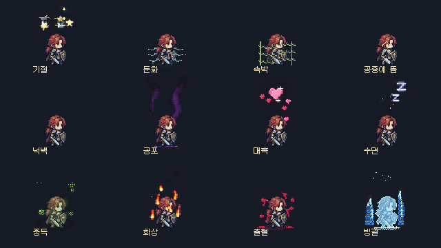

## 작업 결과

데이터·재생성기·런타임매핑 수정,실제Godot렌더·웹문서빌드 완료. 넉백상태와 에어본은 유지합니다.

## 변경 내용

### 적용 내용

statuses.json.knockback.fx와PixelFX매핑을 제거했습니다. exporter가넉백을건너뛰므로 재생성해도복원되지않습니다. 기존출력은art/source/fx/status-runtime/removed-knockback-fx에보존했습니다. 넉백1.5칸밀기·슈퍼아머면역·에어본동작/FX는유지합니다. 상태12종/FX11종입니다. 문서원문·갤러리를갱신하고,웹빌드를막던별도전투데이터의보스공격/추심자공격목록/적공격/몬스터DDT누락필드를한글열과별도목록시트로매핑했습니다. 

## 검증

Godot4.7.2/GTX970 OpenGL 실제상태12종48프레임렌더,스크립트오류없음. 렌더에서넉백화살표FX제거/에어본FX유지확인. node tools/build-design-catalog.mjs 및 node docs/build.mjs성공(13페이지/370이미지). 넉백kind push/value1.5유지,12상태/11FX확인. 테스트·전체회귀는요청하지않아실행하지않았습니다.

## 남은 사항

이번갤러리에서는밀려나는실제동작을재현하지않았으며밀기코드는변경하지않았습니다. 게임배포빌드미실행. 기존user://로그/셰이더캐시쓰기제한·종료텍스처3개경고가남습니다. 중앙게시결과는별도기록합니다. 전역규칙변경없음:기존원본보존/문서동시갱신규칙적용.

## 작업 시간

- 제안 시간: 2026-11-18 16:50:18 KST 시작,2~3분예상
- 실제로 완료된 시간: 구현·실제렌더완료16:51 KST,추가DDT매핑으로웹빌드완료16:53 KST. 중앙등록진행중.
- XERJ: 미사용 — 상태데이터·런타임매핑·실제Godot렌더·문서빌드로확인했습니다.
