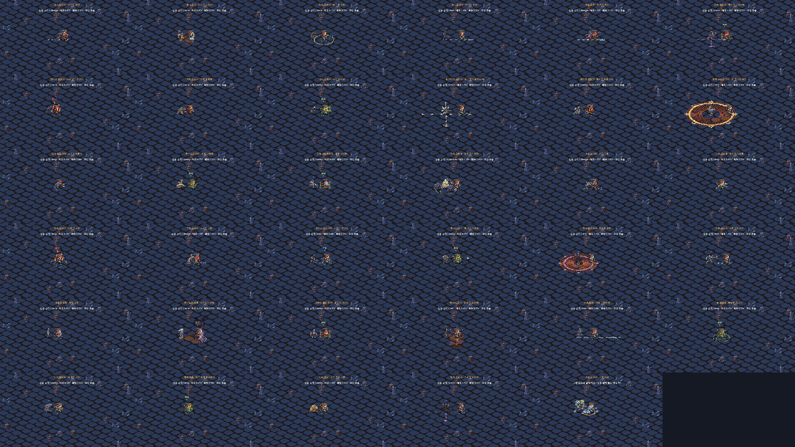
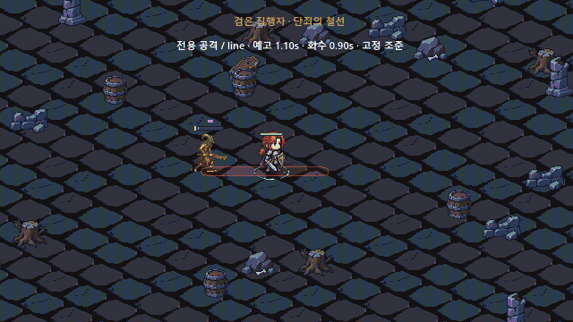
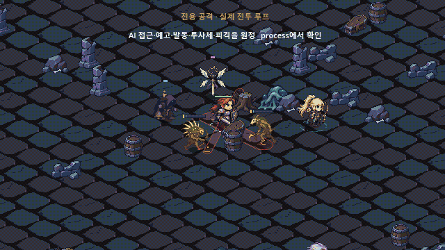

## 작업 결과

구현 완료: 종별 전용 공격68개, 철갑 도살자3패턴의 전용FX, 준비/고정조준/직접판정/회수/필요한 다중타격·발사체·장판·소환·사망 발동을 연결했습니다. 미래 몬스터도 같은 범위로 만들도록 AGENTS.md와 웹 제작 문서 및 중앙 프로젝트 지침을 갱신했습니다.

## 변경 내용

### 적용 내용

monster_attacks.gd가 고정된 task 원점·방향·지점·시계를 예고/판정/AI 위험 평가에 공유합니다. 기존 몬스터 공용 즉시 근접 공격을 우회하고 종별소유 ID·형태·타이밍·모티프를 사용합니다. 종마다 필요에 따라1~3개 공격을 정의했습니다. 다중 고리 안쪽 안전 지대, 양방향 교차선, 원거리 틈, 고정 다중 지점, 도약/돌진, 관통, 설치·사망 효과를 구현했습니다.
PixelFX 코어로 새 종별 모티프를 작성하고 준비/발동/명중+필요한 발사체/잔류236시트를 출력·정규화했습니다. 소스·PNG/JSON·피벗·정규화해시·라이선스를 보존합니다. 강한 상태이상/사망 시 미발동 예약과 돌진을 취소하며, 이미 발사/설치한 효과는 유지합니다. 렌더 연결 누락과 동료 AI의 구형 task.p 참조 문제를 수정했습니다. 전용기·FX·정규화 누락은 데이터 로딩 오류가 되며, 콘텐츠 생성기도 전용 키트를 연결합니다. 기존 개별 외형 등록과 다른 작업은 보존했습니다.

## 검증

Godot4.7.2 실제OpenGL 렌더: 71개 실행,1409프레임,data_errors=[]; 피해형64개 모두 실제 체력감소. 비피해형7개는 방어/소환/사망분열로 구분했습니다. 추가 확인에서 방어3종 guard_until 활성, 강한 상태이상 예약취소·피해0·발동0을 관찰했습니다. 실제 원정 _process에서 자동조종/동료AI를 켜고5종·7개 공격의 시작/발동을 스크립트 오류 없이 확인했습니다. 동료AI 위험평가도 새 형상과 공유합니다.
정규화236시트 및 일치 해시 확인, 문서14페이지·관계도7개 빌드 성공. 한글 데이터 시트에서 몬스터33행·연결능력66행(추심2별도)·전체능력96행을 확인했습니다. 별도 단위/회귀 테스트는 작성하지 않았습니다.

[전체71개 공격 실제 Godot 영상·5fps 기록](../assets/monster-attacks-20261118/all-attacks.mp4)

## 남은 사항

기획 보스5종은 planned이며 구현 완료로 변경하지 않았습니다. 체감 밸런스·청감·장시간 대군 전투는 미확인입니다. 캐릭터 기본 자세와 기존 사운드는 공유하며 종별 새 음원 제작은 하지 않았습니다. 종료 시 기존GL텍스처3개 해제 경고가 남습니다. 게임 저장소의 기존 다수 변경은 커밋·푸시하지 않았고, 중앙 보고와 지침만 분리 게시합니다. 게시·배포·HTTPS 결과는 생성 이후 별도 확인합니다.

## 작업 시간

- 제안 시간: 대형 작업40~60분
- 실제로 완료된 시간: 시작 2026-11-18 16:27:06 KST. 구현·실행·문서·영상 확인 17:14:59 KST(47분53초). 중앙 게시·배포 확인은 이후 진행.
- XERJ: 미사용 — 프로젝트 소스·데이터·PixelFX 로컬 원문과 실제 Godot 실행으로 확인
