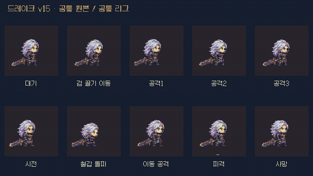

## 작업 결과

원본·프롬프트·등록 좌표·정규화 출력·게임 연결·웹 문서 갱신 및 실제 Godot96프레임 렌더 완료. 다른 배우 PNG106개 해시 동일. 최종 사용자 디자인 평가는 미확인입니다.

## 변경 내용

### 적용 내용

사용자가 제시한 T포즈 뒤 드레이크만 재생성하도록 요청해 드레이크 한정 제작 기준으로 채택했습니다. 별도 원본마다 체형이 달라지던 경로를96자세 단일 원본으로 바꿨습니다. 긴 은백색 머리·보라색 눈·청흑 철갑/황동·자주/청록 천·특대검을 같은 원본에서 공유합니다. 소스128px 셀의 밀도2px당 논리1px(배율0.5)를 공통 적용해80×80/발(40,64)로 출력합니다. 원본의 열/행별 발 위치 편차는 프레임별 발·바닥 기준점의 평행 이동으로 정렬하며 몸체 배율은 바꾸지 않습니다. 프레임의 알파 점유 범위를 배율에 사용하지 않습니다.

대기8/검 끌기16/공격3종각8/시전8/돌파8/피격8/사망8/이동공격16을 원본으로 보존했습니다. 기존40자세 호환 출력에는 시간 재표본화가 포함되며 별도 신규 자세 수로 세지 않습니다. 피격은 생존 반동,사망은 쓰러져 남는 구간,돌파는 돌진 구간으로 의미를 등록했습니다. 게임과 웹 동작표가 reactions-v15의 같은 구간을 사용합니다. v13 제작기가 새 드레이크를 덮어쓰지 않게 보호했습니다.

현재 시트·원본/프롬프트·공통 좌표·이전 출력과 아트 가이드/기준판을 저장했습니다. 웹 문서의 도감·동작 비교·비율 기준 페이지·실제 렌더 GIF와 캐시 해시를 함께 갱신했습니다. 다른 캐릭터의 디자인과 전투 수치는 변경하지 않았습니다.

## 검증

Godot4.7.2/GTX970 OpenGL 실제96프레임,10동작/좌우 출력,종료0/실행 오류0. 실제 게임 초기화에서 hit_pose404/alive=true,death_first408/death_last415,mobility420,data_errors=[]를 확인했습니다. 원본96프레임 시트별 고유 해시96,공통 소스 좌표와 정규화 출력6개 등록. 다른 배우PNG106개 해시 동일. node docs/build.mjs 성공:15페이지/관계도7/이미지434,드레이크 반응 시트와 새GIF 연결 확인. 별도 자동 테스트·전체 회귀는 요청하지 않아 작성/실행하지 않았습니다. 원본 프레임의 발 위치 편차를 발견해 공통 배율을 유지한 채 프레임별 발 기준점만 평행 이동하고 실제96프레임을 다시 렌더했습니다.

## 남은 사항

사람의 최종 디자인·걷기/무게 체감 평가는 미확인입니다. 전체 스킬/FX 부착점의 장기 전투 정밀 대조와 게임 내보내기/배포는 미실행입니다. 다른 캐릭터는 재생성하지 않았습니다. 중앙 등록/푸시/배포는 별도 확인합니다.

## 작업 시간

- 제안 시간: 2026-11-18 17:29:28 KST 시작,15~20분 예상.
- 실제로 완료된 시간: 2026-11-18 17:48:43 KST 최종 발 정렬·실제 재렌더96프레임·게임/문서 저장 완료,실측19분15초. 중앙 최종 보정본 게시 확인은 이후 별도 진행합니다.
- XERJ: 미사용 — 내장 imagegen/배경알파 편집·공통 격자 추출·정규화·소스/PNG 해시·실제 Godot 렌더·게임 연결·웹 빌드.
