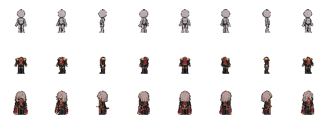

## 작업 결과

원본 저장·분리 PNG·정규화·정적 합성·웹 문서 반영 완료. 동작용 리그 스킨 완성은 미완료입니다.

## 변경 내용

### 적용 내용

첨부 캐릭터를 참고한 imagegen 분리 시안에서8방향 더미·머리카락·의상·망토·장비40레이어를 추출했습니다. 더미는15부위×8방향120PNG로 정적 절단했습니다. 80×80/등록기준 발(40,64), 이진 알파·최근접 리샘플·채널17단계 양자화 후169개 파생 파일을 tools/normalize-art.mjs로 처리했습니다. 편집 원본·해시·상태 JSON·레이어 표시용 preview.html과 도입 코드를 보존했습니다. 기존 공용 리그 원본과 게임 연결은 변경하지 않았습니다. Pixel Art Studio README는 제작 흐름 참고이며 해당 도구·ControlNet을 설치하거나 실행하지 않았습니다.

## 검증

가져오기 실행 성공:8방향/40레이어/120신체조각/169정규화. 각 방향의15조각 재합성과 분리 전 더미의 픽셀 일치 확인. 실제 assembly-board.png를 직접 확인했습니다. node docs/build.mjs 성공:15페이지/7관계도/440이미지. 자동 테스트·Godot 실행·동작 확인은 미실행입니다.

## 남은 사항

관절용 안쪽 겹침과 피벗,해부학적 좌우 부위 대응,머리카락 앞뒤와 의상 관절 분할,망토의 방향별 가림,검과 검집 독립 제작,방향별 등록점 보정,현재2방향 공용 리그 연결과 동작 검증이 남았습니다. 조립판은 정적 초안이며 productionReady=false입니다. 측면/측후면에서 가려진 팔8슬롯은 빈 PNG이며120신체슬롯 중112개에 픽셀이 있습니다. 숨은8부위 복원은 미완료입니다.

## 작업 시간

- 제안 시간: 2026-11-18 21:11:56 KST 시작,분리 원본·조립 미리보기까지10분 이내 예상.
- 실제로 완료된 시간: 2026-11-18 21:16:08 KST 분리·저장·정규화·합성 확인·웹 문서 빌드 완료,실측4분12초. 중앙 등록·배포 시간은 별도 기록합니다.
- XERJ: 미사용 — 공용15파츠 계약 유지,생성 시안과 실제 동작용 분리를 구분하는 기존 규칙을 적용했습니다. 새 전역 지침 추가 없음.
