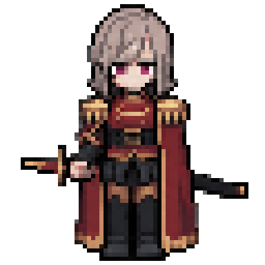

## 작업 결과

64PNG8개·8프레임Aseprite·시트·확대미리보기·ZIP·문서빌드 완료. 게임연결은범위외입니다.

## 변경 내용

### 적용 내용

사용자요청에따라원본전신의영역을약1/6최근접샘플링해64×64캔버스에담았습니다. 실제그림은약55×62~63,발기준행63입니다.색혼합/팔레트양자화없이원본색을선택했습니다.원본512작업캔버스는보존하며축소본은별도폴더입니다.강한경계간격은5/6/4/7순으로많아정확한6배확대64원본이라던추정을정정했습니다.이것은최근접변환이며정확한원본격자복원이라고기록하지않습니다.

## 검증

Aseprite에서실제변환·aseprite저장·재열기·출력성공.8PNG모두64×64,원본에없는RGBA색0개.정면재열기PNG일치.6배정수확대이미지를직접확인했습니다.node docs/build.mjs15페이지/7관계도/444이미지성공.자동테스트/Godot실행은미실행입니다.

## 남은 사항

원본은혼합격자생성이미지라최근접축소시세부형태선택손실이있습니다.정확한논리도트복원물은아닙니다.게임/리그연결및애니메이션은범위외입니다.

## 작업 시간

- 제안 시간: 2026-11-18 22:14:49 KST 시작,64최근접변환과도트대조3~5분예상.
- 실제로 완료된 시간: 2026-11-18 22:16:01 KST 변환/저장/시각확인완료,실측1분12초.8PNG색/크기·재열기확인과문서/ZIP저장은22:17 KST완료.중앙등록시간은별도기록합니다.
- XERJ: 미사용 — 확대이미지해상도와논리도트수를혼동한추정을정정했습니다.관련웹문서에혼합격자와최근접변환한계를기록했습니다.전역지침추가없음.
