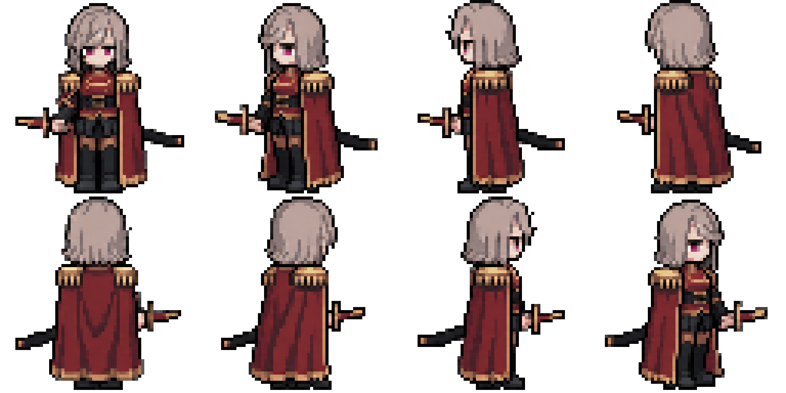

## 작업 결과

8PNG·4×2/1행시트·6배확대미리보기·8프레임Aseprite저장과재열기/반전일치확인·문서갱신완료.

## 변경 내용

### 적용 내용

사용자요청대로기준5방향만사용하고NE=NW좌우반전,E=W좌우반전,SE=SW좌우반전했습니다.캐릭터셀64×64,4×2시트256×128,한줄시트512×64입니다.다른외형으로생성되었던반대편3방향은사용하지않고원본파일은보존했습니다.

## 검증

실제Aseprite배치실행·8프레임원본저장·재열기성공.3쌍모든RGBA픽셀의정확한좌우반전일치,재열기8프레임PNG완전일치확인.6배확대8방향판을직접확인했습니다.웹문서빌드성공.자동테스트/Godot실행은미실행입니다.

## 남은 사항

본8방향시트의파츠분리는아직진행전이며완료로표시하지않습니다.게임연결은범위외입니다.

## 작업 시간

- 제안 시간: 2026-11-18 22:24:04 KST 시작,5기준+3반전재구성2~3분예상.
- 실제로 완료된 시간: 2026-11-18 22:24 KST 8방향저장·시각확인완료.반전/재열기확인·문서·중앙등록은이후실행했으며최종시각은세션최종응답에기록합니다.
- XERJ: 미사용 — 사용자가전체반전을명시요청해비대칭원본보존과별도의5기준3반전시트를제작했습니다.새전역지침없음.
