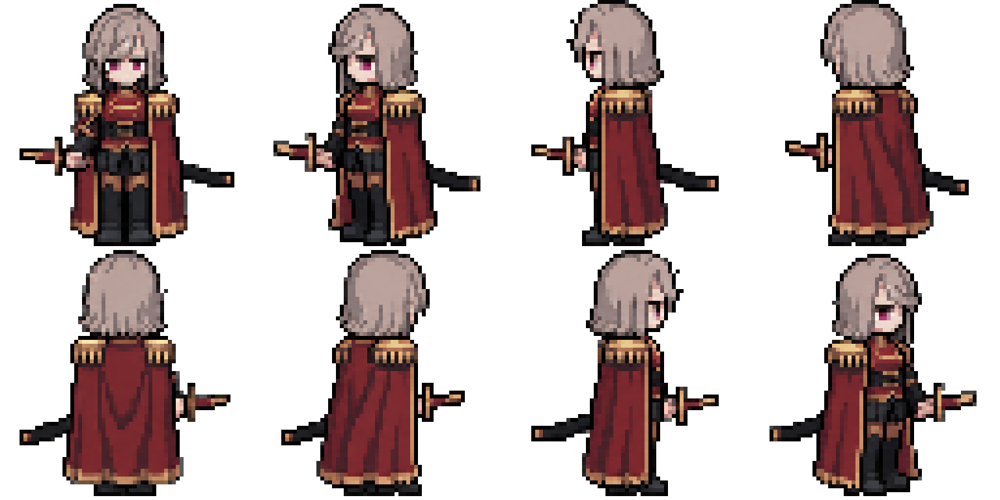

## 작업 결과

프로젝트AGENTS·캐릭터규격·아트워크플로·웹제작가이드갱신과웹빌드완료.

## 변경 내용

### 적용 내용

정면·앞사선·측면·뒤사선·후면5방향제작을기본으로확정했습니다.NE=NW반전,E=W반전,SE=SW반전으로구성하고반대쪽3방향을새로생성하지않습니다.머리카락·의상·장비·동작에도동일하게적용하며사용자가별도비대칭보정을요청할때만해당부분을수정합니다.기존원본/캔버스/등록점을보존하고런타임방향수와공용파츠계약은변경하지않습니다.과거전체반전금지문구를최신확정규칙으로정정했습니다.

## 검증

관련지침원문저장및상충문구정정확인.node docs/build.mjs15페이지/7관계도/445이미지성공.게임코드나아트출력변경없으며자동테스트/Godot실행은미실행입니다.

## 남은 사항

없음.본변경은제작규칙확정이며진행중파츠분리작업의완료를뜻하지않습니다.

## 작업 시간

- 제안 시간: 2026-11-18 22:25:55 KST 시작,지침및문서반영1~2분예상.
- 실제로 완료된 시간: 2026-11-18 22:26 KST 프로젝트지침/문서수정및웹빌드완료.중앙등록및최종완료시각은세션최종응답에기록합니다.
- XERJ: 미사용 — 사용자확정규칙을프로젝트지침에추가하고기존반전금지와의충돌을통합정정했습니다.프로젝트전용규칙으로전역지침은변경하지않았습니다.
