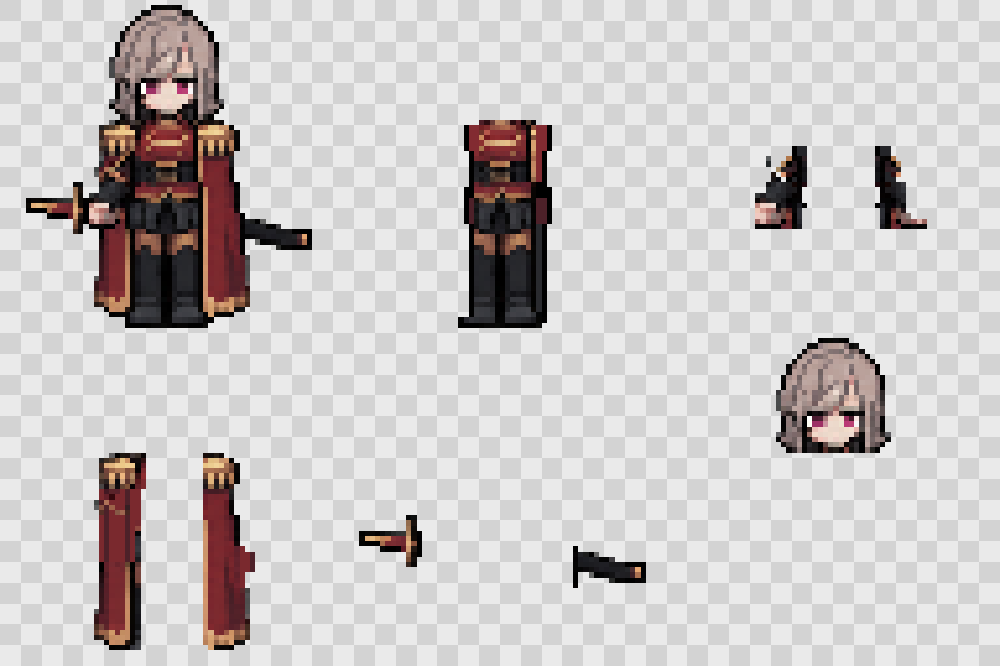

## 작업 결과

64×64개별PNG·8프레임8레이어Aseprite·파트비교판·ZIP·웹문서저장완료.보충아트의관절/동작·게임연결은미완료입니다.

## 변경 내용

### 적용 내용

방향정합을승인받은64원본자체를1픽셀좌표의영역으로분리했습니다.몸·팔·견장소속망토·무기·머리/머리카락5원본레이어와몸/팔/망토3보충레이어로나눴습니다.숨은안쪽은원본팔레트와1픽셀실루엣으로잇고정면의가려진팔에는보이는팔의커프/손픽셀을복사했습니다.원본5방향만작업한후3방향은보충까지완전히반전했습니다.검집끝고립픽셀과망토금테경계를보정했습니다.작업화면용체커보드는미리보기에만넣었습니다.

## 검증

실제Aseprite실행·레이어저장·닫기·재열기성공.최종재열기8프레임모두원본64PNG와RGBA완전일치.3쌍×8레이어모든픽셀의정확한반전일치확인.원본/몸/팔/망토/무기/머리파트비교판을직접확인했습니다.node docs/build.mjs성공.자동테스트/Godot실행·동작확인은미실행입니다.

## 남은 사항

부위별가림과보충은정적기본복원입니다.관절안쪽변형·피벗·공격동작·게임연결과최종아트승인은미확인입니다.재합성일치가관절품질보증을뜻하지않습니다.

## 작업 시간

- 제안 시간: 2026-11-18 22:27:44 KST 시작,기준5방향분리/보충과3반전5~8분예상.
- 실제로 완료된 시간: 2026-11-18 22:33:14 KST 최종마스크/보충·Aseprite저장·재열기·비교판·ZIP완료,실측5분30초.문서/중앙등록시간은별도기록합니다.
- XERJ: 미사용 — 확정5방향+3반전과원본픽셀보존을적용했습니다.프로젝트캐릭터/제작가이드에현행64분리본과미확인범위를반영했고전역지침추가없음.
