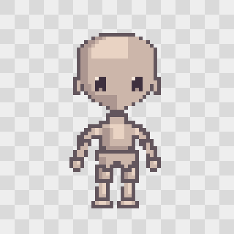

## 작업 결과

정면1칸aseprite·부위PNG·눈없는PNG·확대미리보기·등록점저장및재열기일치확인완료.

## 변경 내용

### 적용 내용

공용15신체슬롯이름을재사용하고정수좌표로중성적인인형몸체를직접그렸습니다.민머리와피부신체에성적세부묘사는없고눈만독립레이어로넣었습니다.64×64/발기준32,56이며기존리그원본은변경하지않았습니다.

## 검증

실제Aseprite배치실행·저장·닫기·재열기PNG완전일치,15신체+눈16레이어등록확인.정면확대미리보기를직접확인했습니다.웹문서빌드성공.자동테스트/Godot실행은미실행입니다.

## 남은 사항

정면체형아트승인·나머지4기준방향+3반전·파츠관절변형·게임연결은미완료입니다.

## 작업 시간

- 제안 시간: 2026-11-18 22:38:46 KST 시작,빠른정면한칸3분이내.
- 실제로 완료된 시간: 2026-11-18 22:40:27 KST 정면저장/재열기/시각확인완료,실측1분41초.문서/중앙등록은이후진행했습니다.
- XERJ: 미사용 — 공용파츠계약과정면체형부터확인하는제작절차를적용했습니다.새전역지침없음.
