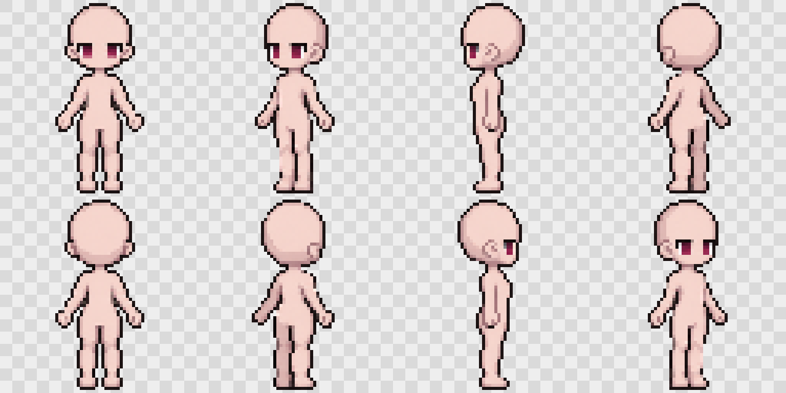

## 작업 결과

256×128시트·원본생성PNG·64개별PNG·눈없는시트·Aseprite2레이어8프레임저장완료.신체15부위세부분리/리그연결은미완료입니다.

## 변경 내용

### 적용 내용

코드도형대신imagegen으로승인얼굴과전신비율을동시참고한무의상민머리더미를제작했습니다.처음정면생성후사용자의8방향지시에맞춰5기준방향시트를추가생성했습니다.이를Aseprite최근접64×64로옮기고NE/E/SE는기준3방향의정확한반전으로출력했습니다.눈픽셀을별도레이어로분리하고그아래피부만인접피부색으로복원했습니다.

## 검증

실제Aseprite축소/눈분리/저장/재열기8프레임일치확인.눈을켜면축소원본과동일.피부/눈각각3쌍정확반전확인.최종8방향6배미리보기를직접확인했습니다.웹문서빌드성공.자동테스트/Godot실행은미실행입니다.

## 남은 사항

아트승인·신체15부위세부분리·관절변형·리그/게임연결은미완료입니다.현재는피부와눈2레이어입니다.

## 작업 시간

- 제안 시간: 2026-11-18 22:45:53 KST 시작,이미지생성→64변환3~5분.진행중8방향으로범위확대했습니다.
- 실제로 완료된 시간: 2026-11-18 22:49:48 KST 생성/64변환/눈분리/8방향저장/시각확인완료,실측3분55초.문서/중앙등록은이후실행했습니다.
- XERJ: 미사용 — 승인그림의제작방법인imagegen으로복귀하고고해상도원본을보존했습니다.확정5원본3반전을적용했으며새전역지침없음.
