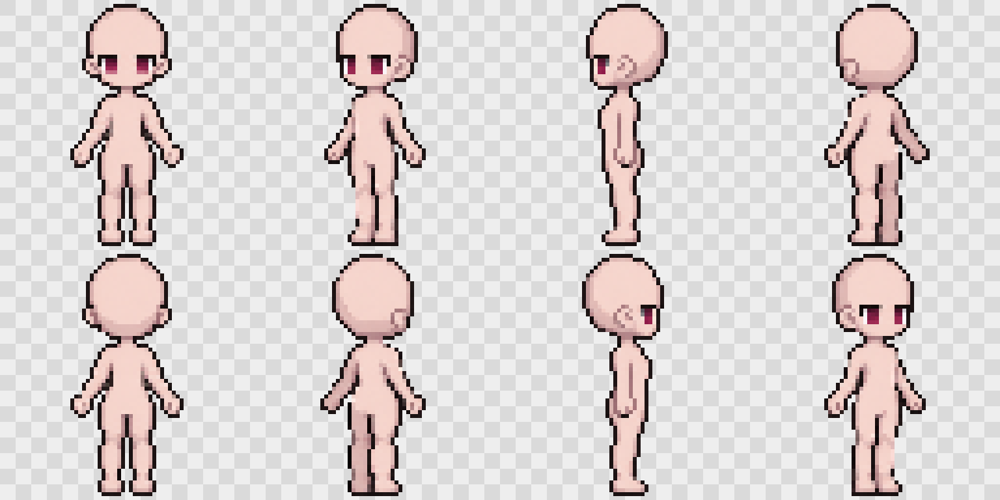

## 작업 결과

원본 보관 목록, 백업 ZIP, 프로젝트 지침 및 웹 제작 가이드 갱신 완료.

## 변경 내용

### 적용 내용

장교 시안과 커마 더미의 대표 원본을 기존 경로에 보존하고 별도 ZIP을 작성했습니다. 현행 제작은 SE 원본과 SW 반전으로 기록했습니다. 8방향 재개 시 이미지 생성부터 공통 기준점, 최근접 64×64 변환, 5방향 제작과 3방향 반전, 파츠별 256×128 조립까지의 절차를 문서화했습니다.

## 검증

백업 ZIP 재열기 및 89개 항목 확인. 웹 문서 빌드 15페이지 성공.

## 남은 사항

8방향 제작 재개는 도트 품질과 파츠 정합 해결 이후입니다. 런타임 변경은 별도 작업입니다.

## 작업 시간

- 제안 시간: 2026-11-18 22:59:33 KST 시작, 예상 2~4분.
- 실제로 완료된 시간: 2026-11-18 22:59 KST 보관 및 문서 빌드 확인. 중앙 등록 시각은 최종 응답에 기록합니다.
- XERJ: 미사용 — 프로젝트 전용 제작 기준과 보관 목록 갱신.
