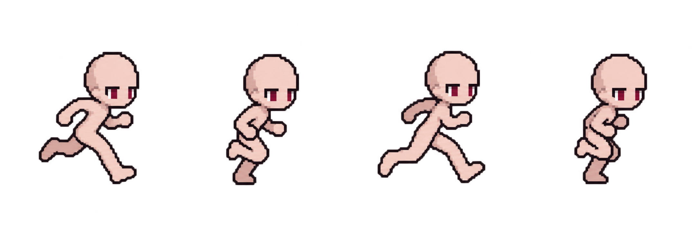

## 작업 결과

PNG 원본 5개, GIF 미리보기 5개, 웹 제작 가이드 갱신 완료.

## 변경 내용

### 적용 내용

사용자 정정 후 기존 커마 더미의 SE 그림을 참조로 이미지 생성했습니다. 공격은 무기를 붙일 수 있도록 빈손 자세를 사용했습니다. GIF는 원본을 네 칸으로 나누고 임시 속도로 재생합니다.

## 검증

각 PNG 육안 확인, GIF마다 4프레임 재열기 확인, 웹 문서 빌드 성공.

## 남은 사항

걷기의 두 접지 자세가 유사합니다. 발과 손 기준점, 공용 리그, 런타임 연결 및 실제 재생 품질은 미확인입니다.

## 작업 시간

- 제안 시간: 2026-11-18 23:04:07 KST, 예상 5~10분.
- 실제로 완료된 시간: 2026-11-18 23:08:14 KST 시안·GIF·웹 빌드 완료, 4분 7초.
- XERJ: 미사용 — 기존 5시 기준 유지.
