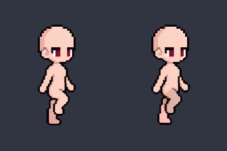

## 작업 결과

원본 유지, 보정 PNG와 GIF 및 2번·4번 비교판 저장.

## 변경 내용

### 적용 내용

교체 포즈 생성 요청이 도구 검토에서 차단됐습니다. 기존 4번의 지지 다리와 들린 다리 명암을 조정했습니다. 향후 접지발과 지지발의 교대 확인을 제작 가이드에 기록했습니다.

## 검증

1~3번 픽셀 일치 확인, 2번과 4번 비교판 육안 확인, 웹 문서 빌드 실행.

## 남은 사항

다리 실루엣과 연결 교대 및 보행 루프 합격 검증.

## 작업 시간

- 제안 시간: 2026-11-18 23:12:47 KST 시작, 예상 3~5분.
- 실제로 완료된 시간: 2026-11-18 23시 KST 수행, 최종 시간은 작업 응답 참조.
- XERJ: 미사용 — 원본 도트와 비교판 대조.
