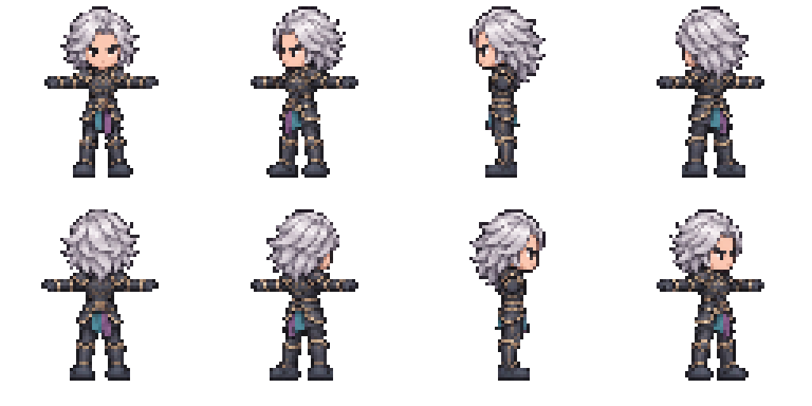

## 작업 결과

생성 원본, 고해상도 8방향 시트, 축소 시트와 확대판을 저장했습니다.

## 변경 내용

### 적용 내용

첨부 마네킹과 드레이크 원본을 함께 참조하고 대검은 빼서 관절이 보이도록 했습니다.

## 검증

반전 3쌍의 픽셀 일치, 정규화, 확대판 육안 확인, 웹 문서 빌드.

## 남은 사항

관절과 파츠 정합, 편집 레이어 및 게임 연결 미확인.

## 작업 시간

- 제안 시간: 23:57:48 KST 시작, 3~5분 예상.
- 실제로 완료된 시간: 완료 시각은 작업 응답에 기록.
- XERJ: 미사용 — 원본과 64픽셀 시트 대조.
