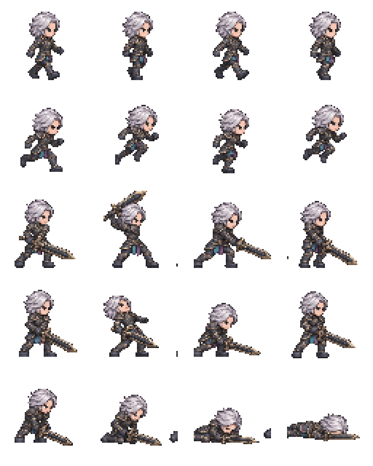

## 작업 결과

고해상도 원본과 4열 5행 PNG, 확대판, 제작 가이드 저장.

## 변경 내용

### 적용 내용

드레이크 T포즈를 참고한 5시 방향 5동작 20자세를 생성했습니다.

## 검증

확대판 육안 확인, 정규화 및 웹 문서 빌드 성공.

## 남은 사항

걷기 2·4번 교대, 일부 픽셀 잔여물과 칸 경계, 팔다리 접지 및 실제 동작 검증.

## 작업 시간

- 제안 시간: 00:06:33 KST 시작, 3~5분 예상.
- 실제로 완료된 시간: 2026-11-19 00:07:28 KST 시안 저장 및 웹 빌드 완료. 55초 소요.
- XERJ: 미사용 — 생성 원본과 확대 시트 대조.
