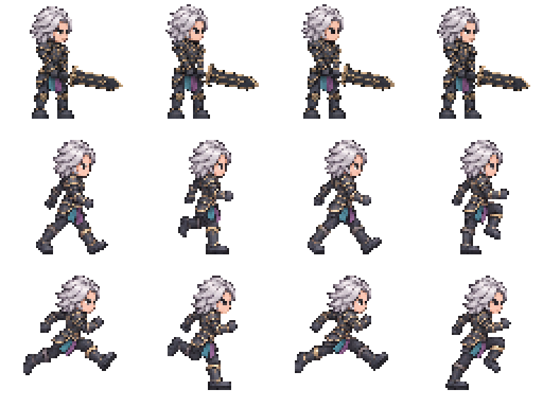

## 작업 결과

원본 2개와 256×192 시트, 확대판을 저장했습니다.

## 변경 내용

### 적용 내용

대기 4자세를 추가하고 이동 8자세를 재생성해 최근접 축소했습니다.

## 검증

원본 2·4번 지지발 육안 비교, 시트 정규화, 웹 빌드.

## 남은 사항

팔 스윙, 접지 궤적 및 게임 재생은 미확인입니다.

## 작업 시간

- 제안 시간: 예상 3~5분.
- 실제로 완료된 시간: 2026-11-19 00:24:24 KST 저장 및 웹 빌드. 시작 시각 미기록.
- XERJ: 미사용 — 생성 원본과 확대 시트 대조.
