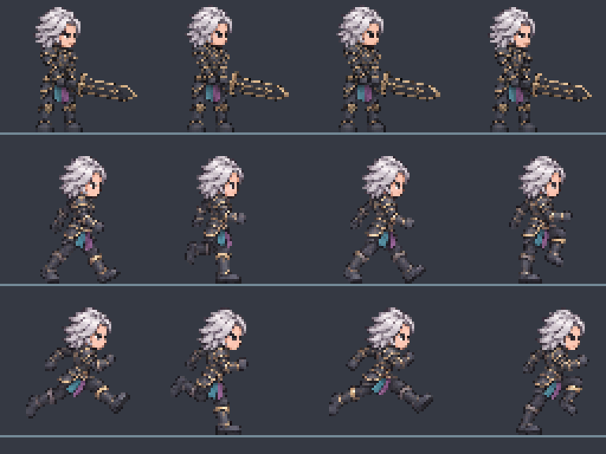

## 작업 결과

접지 시트, 바닥선 비교판, 위치 기록을 저장했습니다.

## 변경 내용

### 적용 내용

걷기와 달리기 2·4번만 가로 이동해 지지발을 정렬했습니다.

## 검증

접지 프레임 55행, 달리기 공중 프레임의 바닥 이격 확인. 웹 빌드 성공.

## 남은 사항

발목 형태와 재생 시 미끄러짐은 미확인.

## 작업 시간

- 제안 시간: 00:42:24 KST 시작, 예상 2~3분.
- 실제로 완료된 시간: 2026-11-19 00:42:48 KST 산출물과 문서 저장, 24초.
- XERJ: 미사용 — 생성 원본과 확대 시트 대조.
