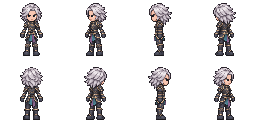

## 작업 결과

생성 원본, 더미와 드레이크 시트, 호흡 GIF, 웹 문서를 저장했습니다.

## 변경 내용

### 적용 내용

다섯 기본 방향을 생성하고 세 방향을 반전했습니다. 상체 1픽셀 이동으로 들숨을 구성했습니다.

## 검증

들숨에서 허리 아래 픽셀 일치 확인, 정규화 및 웹 문서 빌드.

## 남은 사항

대검 장착 상태, 정확한 관절 대응, 게임 재생 미확인.

## 작업 시간

- 제안 시간: 02:01:13 KST 시작, 5~8분 예상.
- 실제로 완료된 시간: 2026-11-19 KST 최종 저장 시간은 응답에 기록.
- XERJ: 미사용 — 더미와 드레이크 생성 원본 및 시트 보존.
