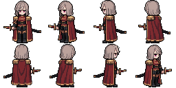

## 작업 결과

256×128 시트 4장과 비교 GIF를 저장하고 웹 문서를 빌드했습니다.

## 변경 내용

### 적용 내용

기존 장교와 자주색 눈의 여성형 더미를 사용했습니다.

## 검증

하체 픽셀 일치, 좌우 반전 일치, 웹 빌드.

## 남은 사항

게임 연결 미완료.

## 작업 시간

- 제안 시간: 3~5분
- 실제로 완료된 시간: 2026-11-19 02:11:38 KST 자산 및 문서 완료, 약 2분
- XERJ: 미사용 — 해당 없음
