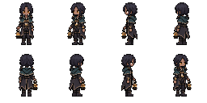

## 작업 결과

생성 원본과 256×128 PNG 두 장 및 반복 GIF를 저장하고 웹 문서를 갱신했습니다.

## 변경 내용

### 적용 내용

5방향 생성 및 3방향 좌우 반전, 상체 1픽셀 호흡 루프

## 검증

하체 프레임 픽셀 일치와 발 높이, GIF 2프레임 반복, 웹 빌드

## 남은 사항

파츠 이식 및 게임 연결

## 작업 시간

- 제안 시간: 4~6분
- 실제로 완료된 시간: 2026-11-19 02:18:31 KST 제작·검증 완료, 1분 2초
- XERJ: 미사용 — 해당 없음
