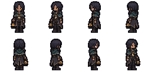

## 작업 결과

기본·날숨 시트, GIF 및 웹 문서를 갱신했습니다.

## 변경 내용

### 적용 내용

외곽에 1픽셀을 추가하고 발 기준선 아래는 제외했습니다.

## 검증

생성기 내 발 높이·하체 픽셀 일치 확인, GIF 육안 확인, 웹 빌드.

## 남은 사항

파츠 이식 및 게임 연결

## 작업 시간

- 제안 시간: 1~2분
- 실제로 완료된 시간: 2026-11-19 02:29:43 KST 제작 완료, 14초
- XERJ: 미사용 — 해당 없음
