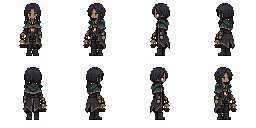

## 작업 결과

기본·날숨 시트, GIF 및 웹 문서를 갱신했습니다.

## 변경 내용

### 적용 내용

기존의 어두운 선 사이에서 몸체와 맞닿는 투명 픽셀만 채웠습니다.

## 검증

외곽 전체 덧칠 출력과 대조, 하체 유지 검사 및 웹 빌드.

## 남은 사항

파츠 이식 및 게임 연결

## 작업 시간

- 제안 시간: 1분 내외
- 실제로 완료된 시간: 2026-11-19 02:30:27 KST 출력 갱신
- XERJ: 미사용 — 해당 없음
