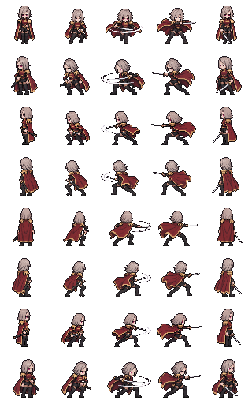

## 작업 결과

320×512 시트, 8방향 GIF, 메타데이터 및 웹 문서.

## 변경 내용

### 적용 내용

64×64 출력에서 실루엣 안쪽 경계 1픽셀을 정리했습니다.

## 검증

40셀의 바닥선, 반전 15셀 픽셀 일치, 시트 육안 확인과 웹 빌드.

## 남은 사항

게임 연결 및 공격 판정 미구현.

## 작업 시간

- 제안 시간: 4~7분
- 실제로 완료된 시간: 2026-11-19 02:50:09 KST 시안과 검증 완료
- XERJ: 미사용 — 해당 없음
