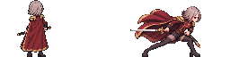

## 작업 결과

128×64 개별 자세 두 장과 정지 비교판 및 웹 문서.

## 변경 내용

### 적용 내용

끝 자세만 새로 생성하고 128×64 셀로 배치.

## 검증

비교판 육안과 두 셀의 발 기준선 확인, 웹 빌드.

## 남은 사항

중간 동작 및 공개 게시 보류.

## 작업 시간

- 제안 시간: 2~4분
- 실제로 완료된 시간: 2026-11-19 03:51:31 KST
- XERJ: 미사용 — 해당 없음
