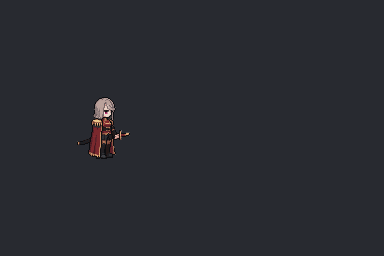

## 작업 결과

아트 제작·게임 연결 구현 완료, 실제 전투 검증·웹 재생성 미완료

## 변경 내용

### 적용 내용

특수기만256×256·21프레임으로 교체. 원본·이전 시트 보존, 정규화 없음. 발도→전진 사선→역올려베기→횡베기. 몸 기준점과 연속120px 이동을 분리해 후반 원위치 복귀 방지. 좌우반전·충돌·강제취소·이동 판정/FX 연동. 타격3/6/11프레임. 도감 크기 메타데이터 적용. 지침과 관련 원문 갱신. 

## 검증

원본 GIF256×256·21프레임 및 접촉판 시각 확인. Godot 임포트 종료0·변경 스크립트 구문 오류 없음. 실제 게임 캡처는 start_run 후 world=null로 실패. docs/build 및 디자인 카탈로그 빌드는 collection_heroes의 미등록 매핑/스키마로 실패. GIF는 실제 게임 렌더가 아닌 원본과 이동 메타데이터 합성 미리보기. 테스트 미작성·미실행.

## 남은 사항

실제 전투의 이동·판정·취소·벽충돌과 사용자 품질 평가 미확인. 신규 collection_heroes 스키마 문제 해결 후 문서 빌드와 전투 실행 필요. 게임 푸시/배포 미실행. 중앙 보고 게시 별도.

## 작업 시간

- 제안 시간: 10분 이내
- 실제로 완료된 시간: 2026-11-19 17:51:56 KST 시작, 2026-11-19 18:00:32 대한민국 표준시 구현 및 시도 종료, 실측 516초. 중앙 등록 별도.
- XERJ: 미사용 — 사용자 금지 지침 준수
